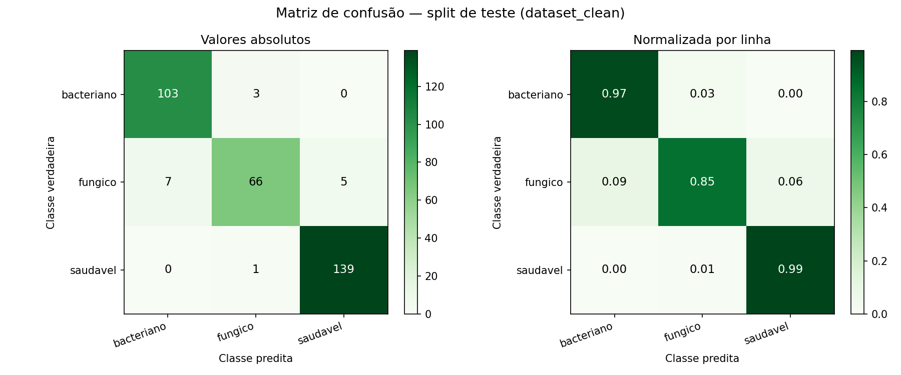
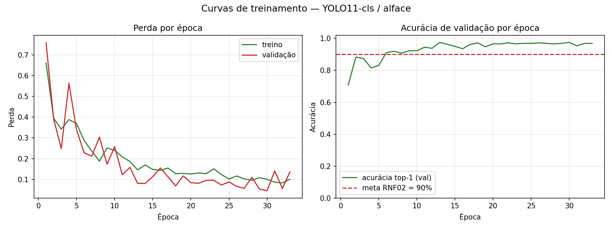

# Avaliação do modelo no split de teste

*Gerado por `desenvolvimento/scripts/03_avaliar.py` em 31/07/2026 00:35.*

| Parâmetro | Valor |
| --- | --- |
| Pesos avaliados | `yolo11n_cls_alface.pt` |
| Split | `desenvolvimento/dataset_clean/test` (324 imagens) |
| Dispositivo | cpu |
| CPU / SO | AMD64 Family 23 Model 24 Stepping 1, AuthenticAMD / Windows-11-10.0.26200-SP0 |
| torch / ultralytics | 2.13.0+cpu / 8.4.95 |

> O split de teste provém de `desenvolvimento/dataset_clean/`, gerado com deduplicação e divisão disjunta por folha de origem. Nenhuma imagem aqui avaliada aparece no treino — ver `desenvolvimento/reports/dataset_auditoria.md`.

## 1. Verificação dos critérios de aceitação

| Critério | Meta | Medido | Status |
| --- | --- | --- | --- |
| RNF02 / H1 — acurácia global | > 90% | 95.06% | **APROVADO** |
| CT01 — confiança média em `fungico` (acertos) | ≥ 0,85 | 0.9561 | **APROVADO** |
| CT02 — confiança média em `bacteriano` (acertos) | ≥ 0,85 | 0.9834 | **APROVADO** |
| CT03 — recall de `saudavel` | ≥ 90% | 99.29% | **APROVADO** |
| CT04 / RNF01 — latência mediana por imagem | < 100 ms | 61.81 ms | **APROVADO** |

A latência acima foi medida no caminho de produção (`DetectorDoencasAlface.predizer`, uma imagem por chamada) durante esta avaliação. Para a medição dedicada, com aquecimento e percentis, ver `desenvolvimento/reports/benchmark_latencia.md`.

## 2. Métricas por classe

| Classe | Precisão | Recall | F1-score | Suporte | Confiança média (acertos) | % acertos ≥ 0,85 |
| --- | ---: | ---: | ---: | ---: | ---: | ---: |
| `bacteriano` | 0.9364 | 0.9717 | 0.9537 | 106 | 0.9834 | 98.1% |
| `fungico` | 0.9429 | 0.8462 | 0.8919 | 78 | 0.9561 | 89.4% |
| `saudavel` | 0.9653 | 0.9929 | 0.9789 | 140 | 0.9884 | 97.1% |

- Acurácia global: **95.06%**
- F1-score macro: **0.9415**

## 3. Matriz de confusão

Valores absolutos (linhas = classe verdadeira, colunas = classe predita):

| verdadeiro \ predito | `bacteriano` | `fungico` | `saudavel` |
| --- | ---: | ---: | ---: |
| `bacteriano` | 103 | 3 | 0 |
| `fungico` | 7 | 66 | 5 |
| `saudavel` | 0 | 1 | 139 |

Normalizada por linha:

| verdadeiro \ predito | `bacteriano` | `fungico` | `saudavel` |
| --- | ---: | ---: | ---: |
| `bacteriano` | 0.972 | 0.028 | 0.000 |
| `fungico` | 0.090 | 0.846 | 0.064 |
| `saudavel` | 0.000 | 0.007 | 0.993 |

## 4. Curvas de treinamento

## 5. Piores casos (inspeção qualitativa)

As imagens estão em `desenvolvimento/reports/erros_classificacao/`. O erro é `1 − probabilidade atribuída à classe verdadeira`.

| # | Verdadeiro | Predito | Confiança | Erro |
| ---: | --- | --- | ---: | ---: |
| 1 | `fungico` | `saudavel` | 1.000 | 1.000 |
| 2 | `fungico` | `bacteriano` | 1.000 | 1.000 |
| 3 | `fungico` | `bacteriano` | 1.000 | 1.000 |
| 4 | `fungico` | `bacteriano` | 0.994 | 0.994 |
| 5 | `fungico` | `bacteriano` | 0.990 | 0.990 |
| 6 | `saudavel` | `fungico` | 0.963 | 0.969 |
| 7 | `bacteriano` | `fungico` | 0.936 | 0.936 |
| 8 | `bacteriano` | `fungico` | 0.932 | 0.932 |
| 9 | `fungico` | `saudavel` | 0.894 | 0.894 |
| 10 | `fungico` | `bacteriano` | 0.798 | 0.804 |
| 11 | `fungico` | `saudavel` | 0.760 | 0.760 |
| 12 | `bacteriano` | `fungico` | 0.746 | 0.749 |
| 13 | `fungico` | `saudavel` | 0.620 | 0.621 |
| 14 | `fungico` | `saudavel` | 0.558 | 0.558 |
| 15 | `fungico` | `bacteriano` | 0.525 | 0.525 |
| 16 | `fungico` | `bacteriano` | 0.518 | 0.520 |
| 17 | `fungico` | `fungico` | 0.533 | 0.467 |
| 18 | `fungico` | `fungico` | 0.563 | 0.437 |
| 19 | `fungico` | `fungico` | 0.581 | 0.419 |
| 20 | `saudavel` | `saudavel` | 0.671 | 0.329 |

## 6. Diagnóstico

A acurácia global de **95.06%** supera a meta de 90% estabelecida em RNF02 e na hipótese H1.

**Atenção:** a classe `fungico` apresenta recall de 84.62%, abaixo de 0,90. Conforme a Seção 6 do spec, este é o gatilho para aplicar sobre-amostragem da classe minoritária ou perda ponderada.
