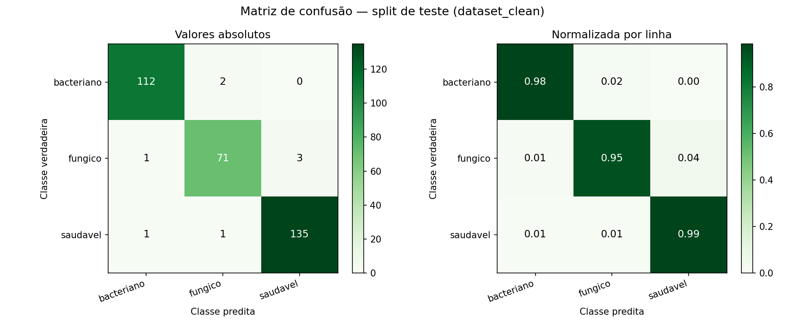
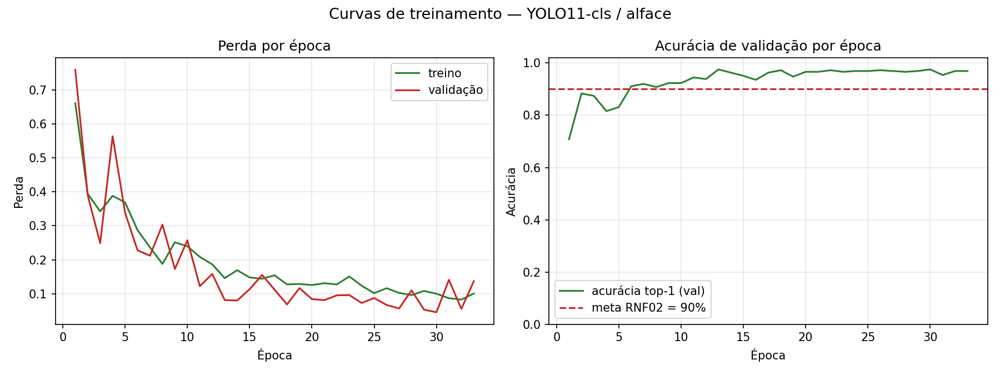

# Avaliação do modelo no split de teste

*Gerado por `desenvolvimento/scripts/03_avaliar.py` em 02/08/2026 18:13.*

| Parâmetro | Valor |
| --- | --- |
| Pesos avaliados | `yolo11n_cls_alface.pt` |
| Split | `desenvolvimento/dataset_clean/test` (326 imagens) |
| Dispositivo | cpu |
| CPU / SO | AMD64 Family 23 Model 24 Stepping 1, AuthenticAMD / Windows-11-10.0.26200-SP0 |
| torch / ultralytics | 2.13.0+cpu / 8.4.95 |

> O split de teste provém de `desenvolvimento/dataset_clean/`, gerado com deduplicação e divisão disjunta por folha de origem. Nenhuma imagem aqui avaliada aparece no treino — ver `desenvolvimento/reports/dataset_auditoria.md`.

## 1. Verificação dos critérios de aceitação

| Critério | Meta | Medido | Status |
| --- | --- | --- | --- |
| RNF02 / H1 — acurácia global | > 90% | 97.55% | **APROVADO** |
| CT01 — confiança média em `fungico` (acertos) | ≥ 0,85 | 0.9719 | **APROVADO** |
| CT02 — confiança média em `bacteriano` (acertos) | ≥ 0,85 | 0.9885 | **APROVADO** |
| CT03 — recall de `saudavel` | ≥ 90% | 98.54% | **APROVADO** |
| CT04 / RNF01 — latência mediana por imagem | < 100 ms | 28.40 ms | **APROVADO** |

A latência acima foi medida no caminho de produção (`DetectorDoencasAlface.predizer`, uma imagem por chamada) durante esta avaliação. Para a medição dedicada, com aquecimento e percentis, ver `desenvolvimento/reports/benchmark_latencia.md`.

## 2. Métricas por classe

| Classe | Precisão | Recall | F1-score | Suporte | Confiança média (acertos) | % acertos ≥ 0,85 |
| --- | ---: | ---: | ---: | ---: | ---: | ---: |
| `bacteriano` | 0.9825 | 0.9825 | 0.9825 | 114 | 0.9885 | 99.1% |
| `fungico` | 0.9595 | 0.9467 | 0.9530 | 75 | 0.9719 | 93.0% |
| `saudavel` | 0.9783 | 0.9854 | 0.9818 | 137 | 0.9983 | 100.0% |

- Acurácia global: **97.55%**
- F1-score macro: **0.9724**

## 3. Matriz de confusão

Valores absolutos (linhas = classe verdadeira, colunas = classe predita):

| verdadeiro \ predito | `bacteriano` | `fungico` | `saudavel` |
| --- | ---: | ---: | ---: |
| `bacteriano` | 112 | 2 | 0 |
| `fungico` | 1 | 71 | 3 |
| `saudavel` | 1 | 1 | 135 |

Normalizada por linha:

| verdadeiro \ predito | `bacteriano` | `fungico` | `saudavel` |
| --- | ---: | ---: | ---: |
| `bacteriano` | 0.983 | 0.018 | 0.000 |
| `fungico` | 0.013 | 0.947 | 0.040 |
| `saudavel` | 0.007 | 0.007 | 0.985 |

## 4. Curvas de treinamento

## 5. Piores casos (inspeção qualitativa)

As imagens estão em `desenvolvimento/reports/erros_classificacao/`. O erro é `1 − probabilidade atribuída à classe verdadeira`.

| # | Verdadeiro | Predito | Confiança | Erro |
| ---: | --- | --- | ---: | ---: |
| 1 | `saudavel` | `fungico` | 0.987 | 0.987 |
| 2 | `bacteriano` | `fungico` | 0.870 | 0.870 |
| 3 | `fungico` | `saudavel` | 0.817 | 0.817 |
| 4 | `fungico` | `saudavel` | 0.802 | 0.802 |
| 5 | `fungico` | `saudavel` | 0.780 | 0.780 |
| 6 | `bacteriano` | `fungico` | 0.699 | 0.700 |
| 7 | `fungico` | `bacteriano` | 0.578 | 0.578 |
| 8 | `saudavel` | `bacteriano` | 0.532 | 0.577 |
| 9 | `fungico` | `fungico` | 0.530 | 0.470 |
| 10 | `fungico` | `fungico` | 0.637 | 0.363 |
| 11 | `fungico` | `fungico` | 0.656 | 0.344 |
| 12 | `fungico` | `fungico` | 0.657 | 0.343 |
| 13 | `bacteriano` | `bacteriano` | 0.682 | 0.318 |
| 14 | `fungico` | `fungico` | 0.847 | 0.153 |
| 15 | `bacteriano` | `bacteriano` | 0.874 | 0.126 |
| 16 | `bacteriano` | `bacteriano` | 0.874 | 0.126 |
| 17 | `bacteriano` | `bacteriano` | 0.905 | 0.095 |
| 18 | `bacteriano` | `bacteriano` | 0.911 | 0.089 |
| 19 | `bacteriano` | `bacteriano` | 0.913 | 0.087 |
| 20 | `fungico` | `fungico` | 0.916 | 0.084 |

## 6. Diagnóstico

A acurácia global de **97.55%** supera a meta de 90% estabelecida em RNF02 e na hipótese H1.
