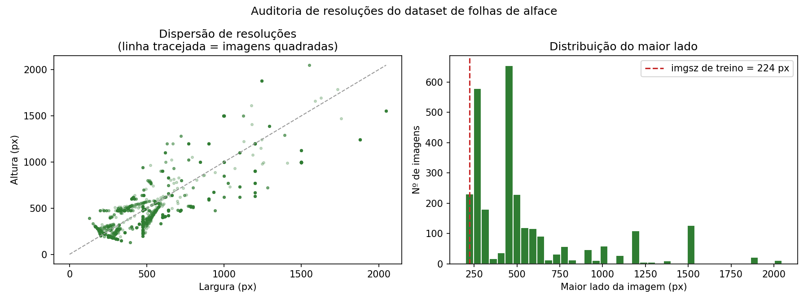

# Auditoria do dataset de folhas de alface

*Gerado automaticamente por `desenvolvimento/scripts/01_preparar_dataset.py` em 10/08/2026 20:06.*

| Parâmetro | Valor |
| --- | --- |
| Dataset de origem | `dataset/` (imutável) |
| Dataset gerado | `dataset_clean/` |
| Proporções | 70% treino / 15% validação / 15% teste |
| Semente | 42 |
| Python / Ultralytics / torch | 3.13.5 / 8.4.95 / 2.13.0+cpu |

Este relatório fundamenta as Seções 6.1.1 (Coleta de dados) e 8 (Limitações do trabalho) do TCC.

## 1. Inventário do dataset original

- Imagens catalogadas: **2813**
- Imagens ilegíveis (ignoradas): **0**
- Formatos: {'JPEG': 987, 'PNG': 1826}
- Modos de cor: {'RGB': 2812, 'RGBA': 1} (todos convertidos para RGB na saída)
- Largura: mín. 129 px, mediana 474 px, máx. 2048 px
- Altura: mín. 129 px, mediana 355 px, máx. 2048 px
- Imagens quadradas: 354 de 2813
- Tamanhos mais frequentes: 225×225 (161), 275×183 (101), 474×355 (100), 183×275 (70), 1500×996 (52)

## 2. Distribuição original por split e classe

| split original | bacteriano | fungico | saudavel | Total | % |
| --- | --- | --- | --- | --- | --- |
| train | 732 | 581 | 1049 | 2362 | 84 |
| test | 75 | 75 | 76 | 226 | 8 |
| valid | 75 | 75 | 75 | 225 | 8 |

> **Problema P5** — a divisão original corresponde a aproximadamente 84/8/8, e não aos 70/15/15 especificados na Seção 6.1.1 do TCC.

## 3. Problema P1 — vazamento por duplicatas exatas

- Arquivos: **2813**
- Hashes MD5 distintos: **2216**
- Arquivos redundantes (cópias byte-idênticas): **597**
- Grupos de duplicatas que **cruzam a fronteira dos splits**: **104**

Métricas medidas sobre o split `test` original seriam cientificamente inválidas: o modelo estaria sendo avaliado em imagens vistas durante o treino, invalidando a verificação de RNF02 e da hipótese H1.

### 3.1 Lista completa dos grupos de duplicatas cruzadas

| # | Classe | Splits afetados | Arquivos |
| ---: | --- | --- | --- |
| 1 | saudavel | test, train | `test/healthy/h10_0.png | train/healthy/h10_2.png | train/healthy/h10_3.png` |
| 2 | fungico | train, valid | `train/fungal/04_2.png | valid/fungal/04_4.png` |
| 3 | bacteriano | test, train | `test/Bacterial/ba27_3.png | train/Bacterial/ba25_4.png | train/Bacterial/ba27_0.png | train/Bacterial/ba27_2.png | train/Bacterial/ba27_4.png` |
| 4 | fungico | train, valid | `train/fungal/s01_0.png | train/fungal/s01_1.png | train/fungal/s01_3.png | train/fungal/s06_0.png | train/fungal/s06_2.png | valid/fungal/s01_2.png` |
| 5 | saudavel | test, train | `test/healthy/h44_0.png | train/healthy/h44_4.png` |
| 6 | saudavel | train, valid | `train/healthy/h99_0.png | train/healthy/h99_3.png | valid/healthy/h99_2.png` |
| 7 | fungico | train, valid | `train/fungal/s10_1.png | valid/fungal/s10_3.png` |
| 8 | saudavel | test, valid | `test/healthy/h33_4.png | valid/healthy/h33_2.png` |
| 9 | bacteriano | test, train, valid | `test/Bacterial/ba1_0 - Copy.png | test/Bacterial/ba1_1.png | train/Bacterial/ba1_1 - Copy.png | train/Bacterial/ba1_4 - Copy.png | train/Bacterial/ba1_4.png | valid/Bacterial/ba1_0.png` |
| 10 | bacteriano | train, valid | `train/Bacterial/ba18_3.png | valid/Bacterial/ba18_0.png` |
| 11 | bacteriano | test, train | `test/Bacterial/th (14)_0.png | test/Bacterial/th (14)_2.png | train/Bacterial/th (14)_4.png` |
| 12 | bacteriano | train, valid | `train/Bacterial/ba35_0.png | train/Bacterial/ba35_4.png | valid/Bacterial/ba35_1.png` |
| 13 | bacteriano | train, valid | `train/Bacterial/th (12)_2.png | valid/Bacterial/th (12)_4.png` |
| 14 | fungico | train, valid | `train/fungal/p17_1.png | train/fungal/p17_4.png | valid/fungal/p17_0.png` |
| 15 | saudavel | train, valid | `train/healthy/h89_3.png | valid/healthy/h89_1.png` |
| 16 | bacteriano | test, train | `test/Bacterial/ba32_2.png | train/Bacterial/ba32_0.png | train/Bacterial/ba32_4.png` |
| 17 | bacteriano | test, train | `test/Bacterial/ba14_0.png | train/Bacterial/ba14_4.png` |
| 18 | saudavel | train, valid | `train/healthy/h62_1.png | train/healthy/h62_2.png | train/healthy/h62_3.png | train/healthy/h64_3.png | train/healthy/h65_3.png | train/healthy/h65_4.png | train/healthy/h67_1.png | valid/healthy/h67_2.png` |
| 19 | bacteriano | train, valid | `train/Bacterial/ba9_0.png | train/Bacterial/ba9_2.png | valid/Bacterial/ba9_4.png` |
| 20 | bacteriano | train, valid | `train/Bacterial/th (2)_3.png | valid/Bacterial/th (2)_0.png` |
| 21 | bacteriano | test, train | `test/Bacterial/ba25_3.png | train/Bacterial/ba25_0.png | train/Bacterial/ba25_1.png` |
| 22 | saudavel | test, train | `test/healthy/h3_2.png | train/healthy/h3_0.png | train/healthy/h3_3.png` |
| 23 | bacteriano | train, valid | `train/Bacterial/ba13_4.png | valid/Bacterial/ba13_1.png` |
| 24 | saudavel | test, train | `test/healthy/h88_1.png | train/healthy/h88_3.png | train/healthy/h88_4.png` |
| 25 | bacteriano | train, valid | `train/Bacterial/th (15)_2.png | valid/Bacterial/th (15)_1.png` |
| 26 | saudavel | train, valid | `train/healthy/h38_0.png | valid/healthy/h38_1.png` |
| 27 | fungico | test, train | `test/fungal/p08_2.png | train/fungal/p08_0.png` |
| 28 | saudavel | train, valid | `train/healthy/h72_3.png | valid/healthy/h72_2.png` |
| 29 | fungico | test, train | `test/fungal/02_0.png | train/fungal/02_1.png | train/fungal/02_2.png` |
| 30 | bacteriano | train, valid | `train/Bacterial/ba20_1.png | train/Bacterial/ba20_3.png | train/Bacterial/ba4_3 - Copy.png | train/Bacterial/ba4_3.png | valid/Bacterial/ba4_2.png` |
| 31 | saudavel | train, valid | `train/healthy/h35_1.png | valid/healthy/h35_0.png` |
| 32 | fungico | test, train, valid | `test/fungal/09_3.png | train/fungal/09_0.png | train/fungal/09_1.png | train/fungal/09_4.png | valid/fungal/09_2.png` |
| 33 | saudavel | test, train | `test/healthy/h87_4.png | train/healthy/h87_1.png | train/healthy/h87_3.png` |
| 34 | saudavel | train, valid | `train/healthy/h46_0.png | train/healthy/h46_1.png | train/healthy/h46_4.png | valid/healthy/h46_2.png` |
| 35 | bacteriano | train, valid | `train/Bacterial/ba34_3.png | valid/Bacterial/ba34_1.png` |
| 36 | fungico | test, train | `test/fungal/s17_0.png | train/fungal/s17_1.png` |
| 37 | saudavel | train, valid | `train/healthy/h94_2.png | valid/healthy/h94_3.png` |
| 38 | bacteriano | train, valid | `train/Bacterial/th (6)_2.png | train/Bacterial/th (6)_4.png | valid/Bacterial/th (6)_3.png` |
| 39 | fungico | test, train | `test/fungal/s10_0.png | train/fungal/s10_2.png | train/fungal/s10_4.png` |
| 40 | saudavel | test, train | `test/healthy/h12_2.png | train/healthy/h12_0.png | train/healthy/h12_3.png` |
| 41 | bacteriano | test, train, valid | `test/Bacterial/ba6_3.png | train/Bacterial/ba15_1.png | train/Bacterial/ba6_0.png | train/Bacterial/ba6_4.png | valid/Bacterial/ba6_3 - Copy.png` |
| 42 | saudavel | test, train | `test/healthy/h5_4.png | train/healthy/h5_3.png` |
| 43 | fungico | test, valid | `test/fungal/wl03_1.png | valid/fungal/wl03_2.png` |
| 44 | saudavel | test, train | `test/healthy/h37_1.png | train/healthy/h37_2.png | train/healthy/h37_4.png` |
| 45 | bacteriano | train, valid | `train/Bacterial/ba19_0.png | train/Bacterial/ba19_3.png | train/Bacterial/ba19_4.png | valid/Bacterial/ba19_2.png` |
| 46 | bacteriano | test, train, valid | `test/Bacterial/th (4)_2.png | train/Bacterial/th (4)_3.png | valid/Bacterial/th (4)_1.png` |
| 47 | saudavel | train, valid | `train/healthy/h39_1.png | valid/healthy/h39_0.png` |
| 48 | bacteriano | train, valid | `train/Bacterial/th (8)_0.png | train/Bacterial/th (8)_3.png | valid/Bacterial/th (8)_2.png` |
| 49 | fungico | train, valid | `train/fungal/p15_0.png | train/fungal/p15_1.png | train/fungal/p15_4.png | valid/fungal/p15_3.png` |
| 50 | saudavel | test, train | `test/healthy/h38_3.png | train/healthy/h38_2.png | train/healthy/h38_4.png` |
| 51 | saudavel | test, train | `test/healthy/h41_0.png | train/healthy/h41_1.png | train/healthy/h41_3.png` |
| 52 | saudavel | test, train | `test/healthy/h15_2.png | train/healthy/h15_0.png | train/healthy/h15_3.png | train/healthy/h15_4.png` |
| 53 | fungico | test, train | `test/fungal/wl04_2.png | train/fungal/wl04_4.png` |
| 54 | saudavel | test, train | `test/healthy/h43_3.png | train/healthy/h43_2.png | train/healthy/h43_4.png` |
| 55 | saudavel | test, train | `test/healthy/h11_0.png | train/healthy/h11_1.png | train/healthy/h11_4.png` |
| 56 | fungico | test, valid | `test/fungal/s11_1.png | valid/fungal/s11_3.png` |
| 57 | fungico | test, train | `test/fungal/15_2.png | train/fungal/15_0.png | train/fungal/15_3.png | train/fungal/15_4.png` |
| 58 | fungico | train, valid | `train/fungal/11_1.png | train/fungal/11_3.png | train/fungal/11_4.png | valid/fungal/11_2.png` |
| 59 | fungico | train, valid | `train/fungal/21_3.png | valid/fungal/21_2.png` |
| 60 | fungico | train, valid | `train/fungal/12_2.png | train/fungal/12_3.png | valid/fungal/12_1.png` |
| 61 | fungico | train, valid | `train/fungal/22_1.png | train/fungal/22_3.png | valid/fungal/22_0.png` |
| 62 | bacteriano | train, valid | `train/Bacterial/th (5)_0.png | valid/Bacterial/th (5)_3.png` |
| 63 | saudavel | test, train | `test/healthy/h11_2.png | train/healthy/h11_3.png` |
| 64 | saudavel | train, valid | `train/healthy/h91_2.png | train/healthy/h91_4.png | valid/healthy/h91_0.png` |
| 65 | saudavel | train, valid | `train/healthy/h71_3.png | valid/healthy/h71_2.png` |
| 66 | fungico | test, train, valid | `test/fungal/17_4.png | train/fungal/17_3.png | valid/fungal/17_1.png` |
| 67 | saudavel | train, valid | `train/healthy/h70_1.png | train/healthy/h70_2.png | valid/healthy/h70_0.png` |
| 68 | saudavel | train, valid | `train/healthy/h97_2.png | train/healthy/h97_3.png | train/healthy/h97_4.png | valid/healthy/h97_0.png` |
| 69 | bacteriano | test, valid | `test/Bacterial/th_2.png | valid/Bacterial/th_4.png` |
| 70 | fungico | train, valid | `train/fungal/wl01_4.png | valid/fungal/wl01_2.png` |
| 71 | fungico | test, train | `test/fungal/p06_1.png | train/fungal/p06_0.png | train/fungal/p06_3.png | train/fungal/p06_4.png` |
| 72 | fungico | test, train | `test/fungal/s02_2.png | train/fungal/s02_1.png | train/fungal/s02_4.png` |
| 73 | bacteriano | test, train | `test/Bacterial/th_0.png | train/Bacterial/th_1.png` |
| 74 | bacteriano | train, valid | `train/Bacterial/ba16_2.png | train/Bacterial/ba16_4.png | valid/Bacterial/ba16_0.png` |
| 75 | fungico | test, train, valid | `test/fungal/16_4.png | train/fungal/16_0.png | train/fungal/16_2.png | train/fungal/16_3.png | valid/fungal/16_1.png` |
| 76 | bacteriano | test, train | `test/Bacterial/th (10)_1.png | train/Bacterial/th (10)_3.png | train/Bacterial/th (10)_4.png` |
| 77 | fungico | train, valid | `train/fungal/18_3.png | valid/fungal/18_0.png` |
| 78 | fungico | train, valid | `train/fungal/20_2.png | valid/fungal/20_3.png` |
| 79 | saudavel | test, train | `test/healthy/h82_3.png | train/healthy/h82_0.png | train/healthy/h82_1.png | train/healthy/h82_2.png` |
| 80 | saudavel | train, valid | `train/healthy/h35_3.png | valid/healthy/h35_4.png` |
| 81 | fungico | train, valid | `train/fungal/p18_1.png | train/fungal/p18_4.png | valid/fungal/p18_3.png` |
| 82 | saudavel | train, valid | `train/healthy/h42_3.png | valid/healthy/h42_2.png | valid/healthy/h42_4.png` |
| 83 | bacteriano | test, train | `test/Bacterial/ba29_2.png | train/Bacterial/ba29_3.png | train/Bacterial/ba29_4.png` |
| 84 | fungico | train, valid | `train/fungal/wl05_2.png | train/fungal/wl05_3.png | train/fungal/wl05_4.png | valid/fungal/wl05_1.png` |
| 85 | fungico | train, valid | `train/fungal/03_1.png | train/fungal/03_2.png | valid/fungal/03_3.png` |
| 86 | bacteriano | test, train, valid | `test/Bacterial/ba5_3.png | train/Bacterial/ba5_2.png | train/Bacterial/ba5_4.png | valid/Bacterial/ba5_1.png` |
| 87 | saudavel | train, valid | `train/healthy/h100_1.png | train/healthy/h100_2.png | train/healthy/h100_3.png | valid/healthy/h100_0.png` |
| 88 | saudavel | train, valid | `train/healthy/h37_3.png | valid/healthy/h37_0.png` |
| 89 | bacteriano | test, train | `test/Bacterial/th (12)_1.png | train/Bacterial/th (12)_0.png | train/Bacterial/th (12)_3.png` |
| 90 | saudavel | train, valid | `train/healthy/h95_0.png | train/healthy/h95_1.png | train/healthy/h95_3.png | valid/healthy/h95_4.png` |
| 91 | fungico | train, valid | `train/fungal/p21_0.png | train/fungal/p21_3.png | train/fungal/p21_4.png | valid/fungal/p21_1.png` |
| 92 | bacteriano | train, valid | `train/Bacterial/ba36_0.png | train/Bacterial/ba36_1.png | valid/Bacterial/ba36_2.png` |
| 93 | saudavel | train, valid | `train/healthy/h34_1.png | train/healthy/h34_3.png | valid/healthy/h34_2.png` |
| 94 | fungico | test, train, valid | `test/fungal/01_0.png | train/fungal/01_2.png | valid/fungal/01_1.png` |
| 95 | bacteriano | test, train | `test/Bacterial/ba23_0.png | train/Bacterial/ba23_4.png` |
| 96 | fungico | test, train | `test/fungal/s08_1.png | train/fungal/s08_4.png` |
| 97 | bacteriano | train, valid | `train/Bacterial/ba12_0 - Copy (2).png | train/Bacterial/ba12_0.png | train/Bacterial/ba12_2.png | train/Bacterial/ba12_3.png | valid/Bacterial/ba12_0 - Copy.png` |
| 98 | bacteriano | test, train | `test/Bacterial/ba28_3.png | train/Bacterial/ba28_0.png` |
| 99 | bacteriano | test, train | `test/Bacterial/th (14)_3.png | train/Bacterial/th (14)_1.png` |
| 100 | bacteriano | train, valid | `train/Bacterial/th (9)_0.png | train/Bacterial/th (9)_2.png | train/Bacterial/th (9)_3.png | valid/Bacterial/th (9)_1.png` |
| 101 | saudavel | test, valid | `test/healthy/h90_2.png | valid/healthy/h90_3.png` |
| 102 | bacteriano | test, train | `test/Bacterial/ba4_1 - Copy.png | train/Bacterial/ba20_2.png | train/Bacterial/ba20_4.png | train/Bacterial/ba4_1.png | train/Bacterial/ba4_4.png` |
| 103 | fungico | train, valid | `train/fungal/wl02_2.png | train/fungal/wl02_4.png | valid/fungal/wl02_1.png` |
| 104 | fungico | train, valid | `train/fungal/s16_0.png | train/fungal/s16_2.png | valid/fungal/s16_3.png` |

## 4. Problemas P2 e P3 — vazamento de grupo e diversidade real

As variantes aumentadas de uma mesma folha seguem o padrão `<origem>_<n>` (por exemplo `ba12_0`, `ba12_2`, `ba12_3`). Agrupá-las impede que a mesma folha apareça em splits diferentes. Adicionalmente, grupos que compartilham arquivos idênticos foram fundidos: o dataset contém nomes de origem distintos apontando para a mesma folha.

| classe | imagens (original) | grupos (por nome) | imagens (após dedup) | grupos (após fusão por conteúdo) | imagens por grupo |
| --- | --- | --- | --- | --- | --- |
| bacteriano | 882 | 653 | 730 | 649 | 1.1 |
| fungico | 731 | 427 | 543 | 426 | 1.3 |
| saudavel | 1200 | 700 | 943 | 695 | 1.4 |

> **Problema P3** — a classe `bacteriano` deriva de um número muito pequeno de folhas originais. Esse é um teto real de generalização e não pode ser corrigido por augmentation; deve constar da Seção 8 do TCC.

## 5. Problema P4 — participação de dados sintéticos

- Arquivos nomeados `augmented_*`: **800** de 2813

| split original | bacteriano | fungico | saudavel |
| --- | --- | --- | --- |
| test | 50 | 50 | 50 |
| train | 500 | 0 | 0 |
| valid | 50 | 50 | 50 |

Nos splits `valid` e `test` originais, esses arquivos representavam a maior parte das imagens, o que tornava a avaliação dependente de dados sintéticos de procedência não rastreável. Cada um foi tratado como grupo unitário na re-divisão.

## 6. Deduplicação

- Imagens descartadas por duplicidade exata: **597**
- Imagens remanescentes: **2216**
- Critério de retenção: menor caminho em ordem lexicográfica (determinístico entre execuções).

## 7. Nova divisão estratificada e disjunta por grupo

| split | bacteriano | fungico | saudavel | Total | % |
| --- | --- | --- | --- | --- | --- |
| train | 510 | 390 | 666 | 1566 | 70.7 |
| val | 114 | 75 | 137 | 326 | 14.7 |
| test | 106 | 78 | 140 | 324 | 14.6 |

Composição percentual de classes dentro de cada split (verificação da estratificação):

| split | bacteriano | fungico | saudavel |
| --- | --- | --- | --- |
| train | 32.6 | 24.9 | 42.5 |
| val | 35 | 23 | 42 |
| test | 32.7 | 24.1 | 43.2 |

## 8. Verificação de integridade

**APROVADO** — zero hashes MD5 e zero grupos de origem compartilhados entre `train`, `val` e `test`. As três classes estão presentes em todos os splits.

## 9. Mapeamento de classes aplicado

| Pasta original | Índice | Rótulo canônico | Exibição |
| --- | :---: | --- | --- |
| `Bacterial` | 0 | `bacteriano` | Bacteriano (Xanthomonas campestris) |
| `fungal` | 1 | `fungico` | Fúngico (Bremia lactucae) |
| `healthy` | 2 | `saudavel` | Saudável |

## 10. Observações para a redação do TCC

1. A Seção 6.1.1 descreve *data augmentation* aplicada na preparação do dataset. Nesta implementação, o aumento de dados é feito **em tempo de treino** pelo Ultralytics, sem gravar imagens em disco. Gravar variantes em disco foi justamente a causa do vazamento identificado nos problemas P1 e P2.
2. A Seção 8 deve registrar a baixa diversidade de folhas originais na classe `bacteriano` (ver item 4 acima) como limitação de generalização.
3. A divisão 70/15/15 exigida pela Seção 6.1.1 foi aplicada sobre os **grupos de folhas**, não sobre arquivos isolados — o que é o procedimento correto quando o conjunto contém variantes da mesma amostra.
