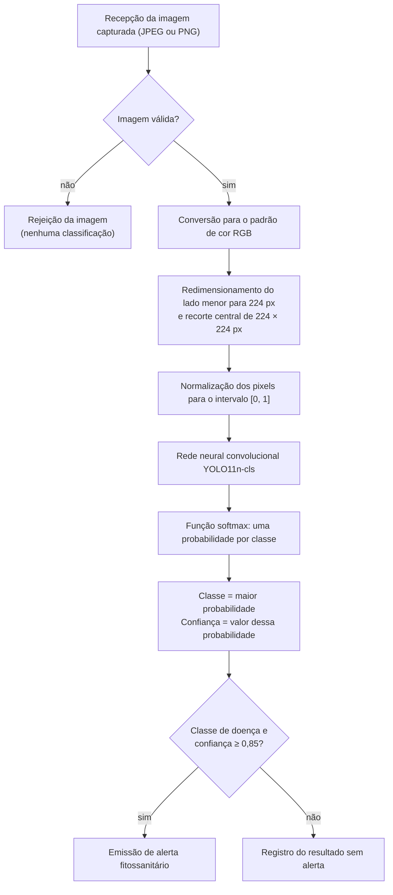
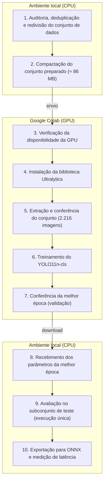
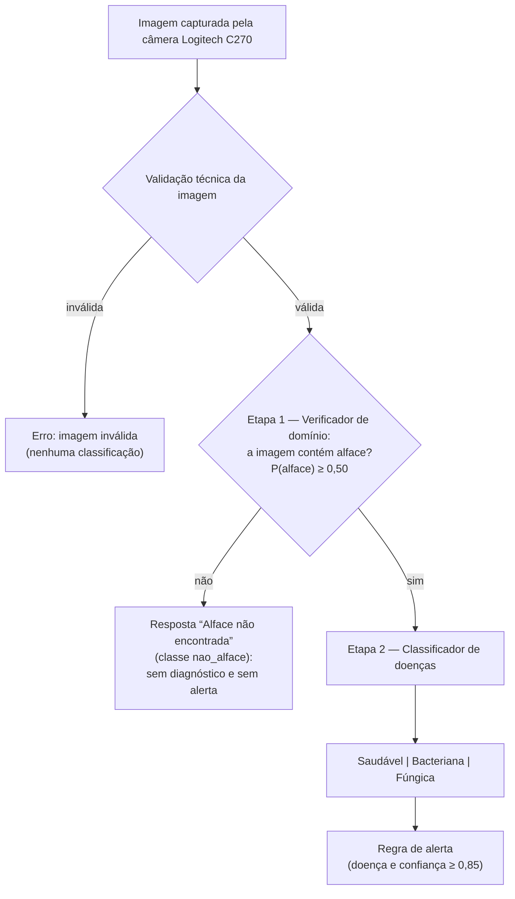
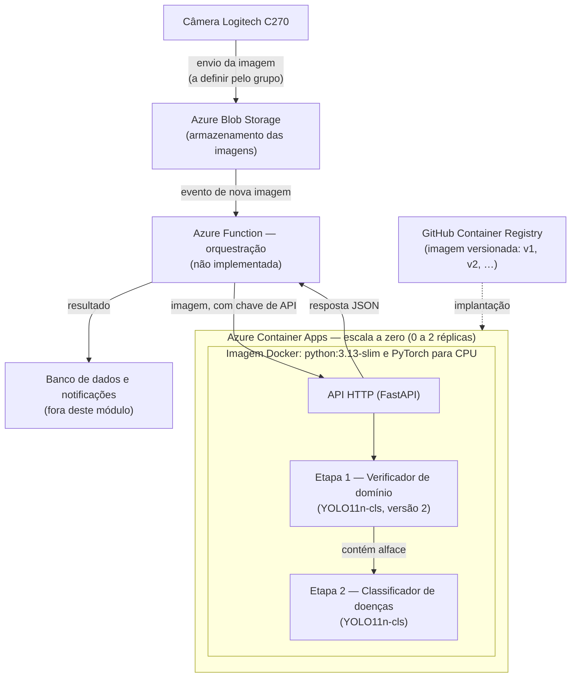
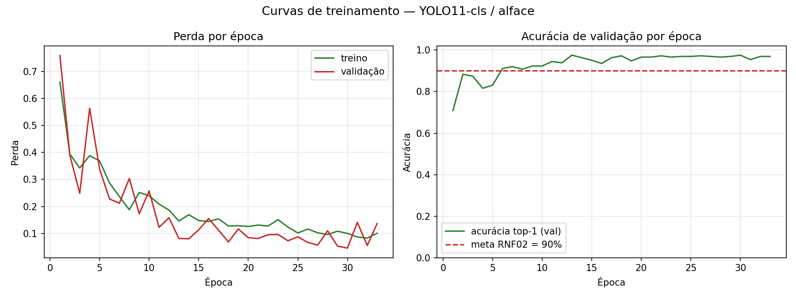
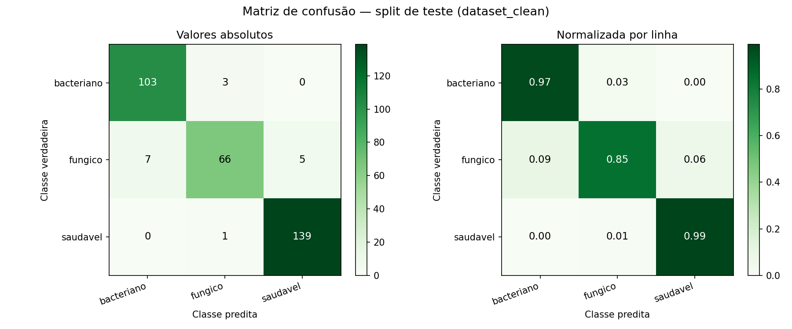

<!--
Formatação ABNT a aplicar ao transpor para o editor de texto (NBR 14724):
papel A4; margens 3 cm (superior e esquerda) e 2 cm (inferior e direita);
Arial ou Times New Roman 12 no texto; tamanho 10 em tabelas, quadros, legendas,
fontes e notas de rodapé; espaçamento 1,5 no texto e simples em tabelas, notas e
referências; recuo de parágrafo de 1,25 cm; texto justificado; seções primárias
iniciam em nova página; títulos de ilustrações acima e fonte abaixo; tabelas sem
bordas laterais (IBGE) e quadros fechados. Renumere seções, tabelas, quadros,
figuras e equações conforme a posição no TCC.
-->

# 1 FUNDAMENTAÇÃO TEÓRICA DO MÓDULO DE INTELIGÊNCIA ARTIFICIAL

Este capítulo apresenta os conceitos que fundamentam o módulo de inteligência artificial do sistema proposto, responsável por identificar, a partir de uma fotografia, se uma folha de alface (*Lactuca sativa*) está saudável ou acometida por doença bacteriana ou fúngica. São descritos o funcionamento das redes neurais convolucionais, o mecanismo pelo qual tais redes reconhecem padrões visuais de doença, a arquitetura adotada, o processo de treinamento e as métricas de avaliação empregadas.

## 1.1 VISÃO COMPUTACIONAL E APRENDIZADO DE MÁQUINA

A visão computacional é a área da computação dedicada a extrair informação útil de imagens digitais. Uma imagem colorida é representada computacionalmente como uma matriz de *pixels*, em que cada *pixel* contém três valores de intensidade, correspondentes aos canais vermelho, verde e azul (padrão RGB), tipicamente no intervalo de 0 a 255. Uma imagem de 224 × 224 *pixels* corresponde, portanto, a 150.528 valores numéricos.

Na abordagem clássica da visão computacional, o projetista define manualmente as características a serem extraídas — por exemplo, limiares de cor para segmentar manchas ou contagens de regiões escuras — e as regras de decisão sobre elas. Na abordagem por aprendizado de máquina, e em particular por aprendizado profundo (*deep learning*), as características são aprendidas automaticamente a partir de exemplos rotulados (LECUN; BENGIO; HINTON, 2015). O Quadro 1 sintetiza as diferenças entre as duas abordagens.

**Quadro 1 – Comparação entre a abordagem clássica e a abordagem por aprendizado profundo**

| Aspecto | Visão computacional clássica | Aprendizado profundo (abordagem adotada) |
| --- | --- | --- |
| Definição das características | Manual, pelo projetista (por exemplo, faixas de matiz no espaço HSV) | Automática, aprendida durante o treinamento |
| Uso da cor | Regra explícita sobre valores de *pixel* | Implícito, combinado com textura e forma |
| Robustez a variações de iluminação | Baixa: limiares fixos deixam de funcionar sob outra iluminação | Maior, quando o treinamento inclui variações |
| Interpretabilidade | Alta: a regra é legível | Baixa: requer técnicas de explicabilidade |
| Volume de dados rotulados | Pequeno | Grande, mitigado por transferência de aprendizado |

Fonte: elaborado pelos autores (2026).

## 1.2 REDES NEURAIS CONVOLUCIONAIS

As redes neurais convolucionais (*Convolutional Neural Networks*, CNN) constituem a classe de modelos de aprendizado profundo predominante em tarefas de reconhecimento de imagens (GOODFELLOW; BENGIO; COURVILLE, 2016). São compostas por camadas sucessivas que transformam a imagem de entrada em representações progressivamente mais abstratas, até produzir a decisão final.

### 1.2.1 Operação de convolução

O elemento fundamental da rede é a operação de convolução. Um filtro (*kernel*) é uma pequena matriz de pesos — no modelo adotado, predominantemente de 3 × 3 — que percorre a imagem. Em cada posição, os valores do filtro são multiplicados pelos valores da região sob ele e os produtos são somados, conforme a Equação (1):

$$
S_{i,j} = \sum_{m}\sum_{n} I(i+m,\ j+n)\cdot K(m,n) + b \qquad (1)
$$

em que *I* representa a imagem (ou o mapa de características da camada anterior), *K* o filtro, *b* um termo de deslocamento (*bias*) e *S* o mapa de saída. O valor resultante em cada posição indica o grau de correspondência entre a região analisada e o padrão representado pelo filtro. Um filtro com pesos positivos de um lado e negativos do outro, por exemplo, responde intensamente a bordas — como a transição entre o tecido verde da folha e uma lesão escura.

Os pesos dos filtros não são definidos pelo projetista: são parâmetros ajustados durante o treinamento, de modo a minimizar o erro de classificação. Cada camada aplica dezenas ou centenas de filtros em paralelo, e cada filtro produz um mapa de características distinto, denominado canal.

### 1.2.2 Normalização e função de ativação

Após cada convolução, o modelo adotado aplica a normalização em lote (*batch normalization*), que padroniza a escala dos valores entre camadas e estabiliza o treinamento, e a função de ativação SiLU (*Sigmoid Linear Unit*), definida pela Equação (2):

$$
f(x) = x \cdot \sigma(x) = \frac{x}{1 + e^{-x}} \qquad (2)
$$

A função de ativação introduz não linearidade no modelo. Sem ela, a composição de todas as camadas equivaleria a uma única transformação linear, incapaz de representar padrões visuais complexos.

### 1.2.3 Redução de resolução e hierarquia de características

Algumas convoluções são aplicadas com passo (*stride*) igual a 2, isto é, o filtro avança dois *pixels* por vez, o que reduz pela metade a altura e a largura do mapa de saída. Com a redução da resolução, cada posição do mapa passa a resumir uma região maior da imagem original, e as camadas seguintes passam a combinar os padrões detectados pelas anteriores.

Disso resulta uma hierarquia de características: as primeiras camadas respondem a padrões elementares, como bordas e gradientes de cor; as intermediárias, a texturas e formas simples; e as finais, a composições complexas. Esse comportamento foi demonstrado experimentalmente por Zeiler e Fergus (2014), por meio da visualização dos padrões que ativam cada camada de uma rede treinada. O Quadro 2 relaciona essa hierarquia ao domínio deste trabalho.

**Quadro 2 – Hierarquia de características de uma rede convolucional aplicada a folhas de alface**

| Nível | Resolução espacial no modelo adotado | Padrões tipicamente detectados | Exemplos no domínio |
| --- | --- | --- | --- |
| Baixo | 112 e 56 *pixels* | Bordas, gradientes de cor, contrastes locais | Contorno da folha; transição do verde para o amarelo; borda de uma mancha |
| Intermediário | 28 e 14 *pixels* | Texturas e formas simples | Superfície crespa; nervuras; manchas pequenas e angulosas; aspecto aveludado |
| Alto | 7 *pixels* | Composições e distribuição espacial | Lesões delimitadas por nervuras; manchas concentradas nas bordas; folha uniformemente verde |
| Decisão | Vetor sem dimensão espacial | Combinação ponderada das evidências | Conjunto de evidências compatível com uma das classes |

Fonte: elaborado pelos autores (2026), com base em Zeiler e Fergus (2014).

Ressalte-se que o Quadro 2 descreve a tendência geral documentada na literatura. Os filtros aprendidos não possuem significado rotulado, de modo que não é possível afirmar com exatidão qual conceito visual cada um representa no modelo treinado.

## 1.3 MECANISMO DE IDENTIFICAÇÃO DAS DOENÇAS FOLIARES

### 1.3.1 Características visuais empregadas pela rede

O modelo desenvolvido não contém regras explícitas de diagnóstico. Em nenhuma etapa do processamento existe instrução do tipo “manchas marrons indicam doença bacteriana” ou “coloração pálida indica míldio”. A rede aprendeu, a partir de 1.566 imagens rotuladas, quais combinações de características visuais distinguem cada classe.

A cor participa do processo desde a primeira camada, uma vez que a entrada da rede são os três canais RGB, e os filtros iniciais combinam esses canais, respondendo a variações cromáticas como o amarelecimento e o escurecimento do tecido. Contudo, a decisão final resulta da combinação da cor com outras três famílias de características:

a) **textura**: o padrão de repetição da superfície, como o aspecto aveludado da esporulação ou o aspecto encharcado das lesões bacterianas;

b) **forma**: a geometria das lesões, como contornos angulosos ou circulares;

c) **distribuição espacial**: a localização das lesões na folha, como a concentração junto às bordas ou a delimitação pelas nervuras.

Essa combinação confere ao modelo vantagem sobre critérios exclusivamente cromáticos, que tenderiam a confundir, por exemplo, o amarelecimento causado por deficiência nutricional com os sintomas iniciais do míldio. Tal capacidade de distinção, entretanto, depende da presença de exemplos desses casos no conjunto de treinamento, condição não atendida pelo conjunto empregado, conforme discutido no Capítulo 4.

### 1.3.2 Sintomas visuais das classes

O Quadro 3 descreve os sintomas visuais característicos de cada classe considerada. Trata-se dos padrões presentes nas imagens de treinamento e, portanto, disponíveis para o aprendizado da rede. A classe denominada fúngica corresponde ao míldio, causado por *Bremia lactucae*[^1]; a classe bacteriana corresponde à mancha bacteriana, causada por *Xanthomonas campestris* pv. *vitians*.

**Quadro 3 – Características visuais das classes consideradas**

| Classe | Cor | Textura | Forma e distribuição |
| --- | --- | --- | --- |
| Saudável | Verde uniforme, conforme a cultivar | Superfície regular, lisa ou crespa conforme a cultivar | Ausência de manchas; nervuras contínuas |
| Fúngica (míldio, *Bremia lactucae*) | Áreas verde-pálidas a amareladas na face superior, que escurecem com a progressão | Crescimento esbranquiçado e aveludado, sobretudo na face inferior | Lesões angulosas, delimitadas pelas nervuras |
| Bacteriana (*Xanthomonas campestris* pv. *vitians*) | Manchas inicialmente translúcidas, depois marrom-escuras a negras, por vezes com halo amarelado | Aspecto encharcado; tecido necrosado | Manchas pequenas e angulosas, que podem coalescer; frequentes junto às bordas |

Fonte: elaborado pelos autores (2026). **[PREENCHER: referência fitopatológica que descreva os sintomas.]**

Observa-se que ambas as doenças produzem lesões angulosas. Essa semelhança visual é coerente com o padrão de erros observado nos resultados, em que a principal confusão ocorre entre as classes fúngica e bacteriana (Seção 3.5).

## 1.4 ARQUITETURA YOLO11 PARA CLASSIFICAÇÃO

A família de modelos YOLO (*You Only Look Once*) é amplamente empregada em visão computacional por equilibrar exatidão e velocidade de execução. Em sua décima primeira geração, denominada YOLO11, a biblioteca Ultralytics disponibiliza variantes para detecção de objetos, segmentação, estimativa de pose e classificação de imagens (JOCHER; QIU, 2024). Este trabalho emprega a variante de classificação no menor porte disponível, denominada YOLO11n-cls (*nano*), cujas características constam da Tabela 1.

**Tabela 1 – Características do modelo YOLO11n-cls empregado**

| Característica | Valor |
| --- | ---: |
| Parâmetros treináveis (três classes) | 1.534.947 |
| Camadas | 86 (47 após a fusão de convolução e normalização) |
| Dimensão da entrada | 3 × 224 × 224 |
| Dimensão da saída | 3 probabilidades |
| Tamanho do arquivo de pesos | 3,19 MB |

Fonte: elaborado pelos autores (2026).

O modelo divide-se em duas partes. O extrator de características (*backbone*) transforma a imagem em um conjunto de mapas de características de baixa resolução e grande número de canais. A cabeça de classificação converte esses mapas em uma probabilidade para cada classe. A Figura 1 ilustra a sequência de blocos, detalhada no Quadro 4.

**Figura 1 – Estrutura do modelo YOLO11n-cls**

```mermaid
flowchart LR
    E["Entrada<br/>3×224×224"] --> C0["Conv<br/>16×112×112"] --> C1["Conv<br/>32×56×56"] --> K2["C3k2<br/>64×56×56"]
    K2 --> C3["Conv<br/>64×28×28"] --> K4["C3k2<br/>128×28×28"] --> C5["Conv<br/>128×14×14"] --> K6["C3k2<br/>128×14×14"]
    K6 --> C7["Conv<br/>256×7×7"] --> K8["C3k2<br/>256×7×7"] --> A9["C2PSA<br/>256×7×7"]
    A9 --> H1["Conv 1×1<br/>1.280×7×7"] --> H2["Agrupamento<br/>médio global<br/>1.280"] --> H3["Linear<br/>3"] --> H4["Softmax<br/>3 probabilidades"]
    subgraph Extrator de características
        C0
        C1
        K2
        C3
        K4
        C5
        K6
        C7
        K8
        A9
    end
    subgraph Cabeça de classificação
        H1
        H2
        H3
        H4
    end
```

Fonte: elaborado pelos autores (2026), com base em Jocher e Qiu (2024).

**Quadro 4 – Camadas do modelo YOLO11n-cls para entrada de 224 × 224 *pixels***

| Ordem | Bloco | Função | Saída (canais × altura × largura) |
| :---: | --- | --- | --- |
| — | Entrada | Imagem RGB normalizada | 3 × 224 × 224 |
| 0 | Conv 3 × 3, passo 2 | Bordas e cores elementares; reduz a resolução | 16 × 112 × 112 |
| 1 | Conv 3 × 3, passo 2 | Padrões locais simples | 32 × 56 × 56 |
| 2 | C3k2 | Combinação de padrões; texturas iniciais | 64 × 56 × 56 |
| 3 | Conv 3 × 3, passo 2 | Redução de resolução | 64 × 28 × 28 |
| 4 | C3k2 | Texturas e formas pequenas | 128 × 28 × 28 |
| 5 | Conv 3 × 3, passo 2 | Redução de resolução | 128 × 14 × 14 |
| 6 | C3k2 | Formas maiores e agrupamentos | 128 × 14 × 14 |
| 7 | Conv 3 × 3, passo 2 | Redução de resolução | 256 × 7 × 7 |
| 8 | C3k2 | Padrões de alto nível | 256 × 7 × 7 |
| 9 | C2PSA | Atenção espacial entre regiões da folha | 256 × 7 × 7 |
| 10 | Conv 1 × 1 | Expansão para 1.280 características | 1.280 × 7 × 7 |
| 10 | Agrupamento médio global | Média de cada canal sobre as 49 posições | 1.280 |
| 10 | *Dropout* (somente no treinamento) | Regularização | 1.280 |
| 10 | Camada linear | Uma pontuação por classe | 3 |
| 10 | *Softmax* | Conversão das pontuações em probabilidades | 3 |

Fonte: elaborado pelos autores (2026), com base em Jocher e Qiu (2024).

Os blocos indicados como Conv compreendem convolução, normalização em lote e ativação SiLU. Após cinco convoluções com passo 2, a resolução de 224 *pixels* reduz-se a 7, de modo que cada posição do mapa final resume uma região de 32 × 32 *pixels* da imagem original.

O bloco C3k2 segue o princípio *Cross Stage Partial*: divide os canais em dois ramos, processa um deles por uma sequência de convoluções com conexões residuais e reúne os dois ao final, ampliando a capacidade de representação com baixo número de parâmetros. O bloco C2PSA (*Position-Sensitive Attention*) aplica um mecanismo de autoatenção, pelo qual cada posição do mapa de 7 × 7 pode ponderar as informações de todas as demais, o que permite relacionar lesões dispersas pela folha.

Na cabeça de classificação, o agrupamento médio global (*Global Average Pooling*) calcula a média de cada um dos 1.280 canais sobre todas as posições espaciais. O vetor resultante descreve quais padrões estão presentes na imagem, mas não onde estão. Por essa razão, o modelo de classificação não fornece a localização das lesões.

## 1.5 FUNÇÃO *SOFTMAX* E GRAU DE CONFIANÇA

A camada linear final produz três valores reais, denominados *logits*, um para cada classe. A função *softmax*, expressa na Equação (3), converte esses valores em probabilidades:

$$
p_i = \frac{e^{z_i}}{\sum_{j=1}^{3} e^{z_j}} \qquad (3)
$$

em que *z*i é o *logit* da classe *i* e *p*i a probabilidade correspondente. Os valores resultantes situam-se entre 0 e 1 e somam exatamente 1. A classe de maior probabilidade constitui a resposta do modelo, e o valor dessa probabilidade é denominado confiança.

Uma consequência dessa formulação é que o modelo sempre atribui a imagem a uma das três classes conhecidas, inclusive quando a imagem não contém uma folha de alface. Essa propriedade motiva a etapa de verificação de domínio descrita na Seção 2.9.

## 1.6 TREINAMENTO SUPERVISIONADO

Treinar a rede consiste em ajustar seus parâmetros de modo a minimizar o erro sobre um conjunto de imagens cujas classes são conhecidas. O processo repete, a cada lote de imagens, quatro etapas:

a) propagação direta: o lote atravessa a rede, que produz as probabilidades de cada classe;

b) cálculo da perda: as probabilidades são comparadas aos rótulos verdadeiros;

c) retropropagação (*backpropagation*): calcula-se, pela regra da cadeia, o gradiente da perda em relação a cada parâmetro, isto é, a contribuição de cada parâmetro para o erro;

d) atualização: o otimizador ajusta cada parâmetro na direção que reduz a perda.

Denomina-se época uma passagem completa por todas as imagens do conjunto de treinamento.

### 1.6.1 Função de perda

Empregou-se a entropia cruzada (*cross-entropy*), que, para uma imagem cuja classe verdadeira é *y*, assume a forma da Equação (4):

$$
L = -\ln(p_y) \qquad (4)
$$

Se o modelo atribui probabilidade 0,99 à classe correta, a perda é de 0,01; se atribui 0,10, a perda é de 2,30. A função penaliza, assim, de forma acentuada as predições incorretas feitas com alta confiança.

### 1.6.2 Otimizador

Utilizou-se o otimizador AdamW (LOSHCHILOV; HUTTER, 2019), que adapta o tamanho do passo de cada parâmetro individualmente, com base em médias móveis do gradiente e de seu quadrado, e aplica o decaimento de pesos (*weight decay*) de forma desacoplada da atualização pelo gradiente. O decaimento de pesos favorece parâmetros de pequena magnitude, o que reduz a tendência ao sobreajuste.

### 1.6.3 Taxa de aprendizado

A taxa de aprendizado determina a magnitude de cada passo de atualização. Adotou-se um período inicial de aquecimento (*warmup*) de três épocas, durante o qual a taxa cresce gradualmente até o valor nominal, seguido de decaimento cossenoidal (LOSHCHILOV; HUTTER, 2017), descrito pela Equação (5):

$$
\eta(t) = \eta_0 \cdot \left[1 - (1 - f)\cdot\frac{1 - \cos\left(\frac{\pi t}{T}\right)}{2}\right] \qquad (5)
$$

em que *η*0 é a taxa inicial, *f* a fração final, *t* a época (contada a partir de zero) e *T* o número máximo de épocas. Com *η*0 = 0,001, *f* = 0,01 e *T* = 100, a taxa decresce suavemente até 0,00001. O aquecimento evita que os gradientes elevados das primeiras iterações degradem o conhecimento previamente adquirido pelo modelo.

### 1.6.4 Sobreajuste e regularização

O sobreajuste (*overfitting*) ocorre quando o modelo memoriza as particularidades das imagens de treinamento, em vez de aprender padrões generalizáveis, e manifesta-se por desempenho elevado no treinamento e inferior em imagens novas. Foram adotados quatro mecanismos de regularização: o aumento de dados (Seção 2.4); o *dropout*, que anula aleatoriamente uma fração das características durante o treinamento; o decaimento de pesos; e a parada antecipada (*early stopping*), que interrompe o treinamento quando o desempenho no subconjunto de validação deixa de melhorar por um número predefinido de épocas, denominado paciência, preservando os parâmetros da melhor época.

## 1.7 TRANSFERÊNCIA DE APRENDIZADO

O treinamento não partiu de parâmetros aleatórios. Utilizaram-se como ponto de partida os parâmetros do modelo previamente treinado sobre o conjunto ImageNet, composto por aproximadamente 1,28 milhão de imagens de 1.000 categorias. Apenas a camada linear final, originalmente com 1.000 saídas, foi substituída por outra com três saídas; os demais parâmetros foram aproveitados e ajustados (*fine-tuning*).

A estratégia fundamenta-se na constatação de que as camadas iniciais de redes treinadas sobre grandes conjuntos aprendem detectores genéricos de bordas, cores e texturas, úteis a domínios visuais diversos (YOSINSKI et al., 2014). O aproveitamento desse conhecimento reduz substancialmente o volume de dados necessário, fator decisivo diante das 1.566 imagens de treinamento disponíveis. Mohanty, Hughes e Salathé (2016) demonstraram a eficácia da transferência de aprendizado especificamente no diagnóstico de doenças de plantas por imagem.

## 1.8 EXPLICABILIDADE POR GRAD-CAM

Para permitir a inspeção das decisões do modelo, adotou-se a técnica Grad-CAM (*Gradient-weighted Class Activation Mapping*), proposta por Selvaraju et al. (2017). A técnica calcula a importância de cada canal *k* da última camada convolucional para a classe *c*, conforme a Equação (6):

$$
\alpha_k^c = \frac{1}{Z}\sum_{i}\sum_{j}\frac{\partial y^c}{\partial A_{ij}^k} \qquad (6)
$$

em que *y*c é a pontuação da classe *c*, *A*k o mapa de ativação do canal *k* e *Z* o número de posições espaciais. O mapa de calor resulta da combinação ponderada dos mapas de ativação, mantidos apenas os valores positivos, conforme a Equação (7):

$$
L_{\text{Grad-CAM}}^c = \mathrm{ReLU}\left(\sum_{k}\alpha_k^c A^k\right) \qquad (7)
$$

No modelo adotado, o mapa possui resolução de 7 × 7 e corresponde ao recorte central de 224 × 224 *pixels* analisado pela rede (Seção 2.3). Para a sobreposição, é ampliado até as dimensões dessa região da imagem original, e as faixas descartadas pelo recorte permanecem sem sobreposição; esticá-lo sobre a imagem inteira deslocaria as regiões destacadas em imagens não quadradas, como as de 1280 × 720 *pixels* da câmera do sistema. As regiões destacadas correspondem às que mais influenciaram a decisão. A técnica atende a duas finalidades: fornece indicação aproximada da localização da lesão, sem exigir anotação manual; e permite identificar o aprendizado por atalho (*shortcut learning*), situação em que o modelo acerta com base em elementos irrelevantes, como o fundo da imagem (GEIRHOS et al., 2020). Cumpre observar que o Grad-CAM indica onde o modelo concentrou sua atenção, mas não qual característica — cor, textura ou forma — determinou a decisão.

## 1.9 MÉTRICAS DE AVALIAÇÃO

O desempenho foi avaliado por métricas derivadas da matriz de confusão, tabela que cruza a classe real de cada imagem com a classe predita. Para cada classe, denominam-se verdadeiros positivos (VP) as imagens da classe corretamente identificadas; falsos positivos (FP) as imagens de outras classes atribuídas a ela; e falsos negativos (FN) as imagens da classe atribuídas a outras. As métricas são definidas pelas Equações (8) a (10):

$$
\text{Precisão} = \frac{VP}{VP + FP} \qquad (8)
$$

$$
\text{Revocação} = \frac{VP}{VP + FN} \qquad (9)
$$

$$
F_1 = \frac{2 \cdot \text{Precisão} \cdot \text{Revocação}}{\text{Precisão} + \text{Revocação}} \qquad (10)
$$

A precisão indica, entre as imagens atribuídas a uma classe, a proporção que de fato pertence a ela; precisão elevada corresponde a poucos alarmes falsos. A revocação (*recall*) indica, entre as imagens de uma classe, a proporção identificada pelo modelo; revocação elevada corresponde a poucas doenças não detectadas. O F1-*score* é a média harmônica das duas. A acurácia é a proporção de classificações corretas sobre o total, e a média macro é a média aritmética de uma métrica entre as três classes, sem ponderação pelo número de imagens, o que atribui igual importância à classe menos numerosa.

---

# 2 DESENVOLVIMENTO DO MODELO DE CLASSIFICAÇÃO

Este capítulo descreve os materiais e os procedimentos empregados no desenvolvimento do modelo: a definição da tarefa, o tratamento do conjunto de dados, o pré-processamento, o aumento de dados, o treinamento na plataforma Google Colab, o procedimento de avaliação e a integração ao sistema. Descreve, ainda, a etapa de verificação de que a imagem contém uma folha de alface, cujos resultados constam da Seção 3.8, e a implantação do serviço em contêiner na nuvem.

## 2.1 DEFINIÇÃO DA TAREFA

O projeto original previa a detecção de objetos, com delimitação das lesões por caixas delimitadoras. A análise do conjunto de dados obtido demonstrou, contudo, a inexistência de anotações de localização: as imagens são rotuladas apenas em nível de imagem inteira, por meio da organização em diretórios por classe. Adotou-se, por conseguinte, a tarefa de classificação de imagens, que atende ao requisito RF02 — identificar se a folha está saudável ou com infecção bacteriana ou fúngica — e aos casos de teste CT01 a CT03, formulados em termos de classe e confiança. A orientação espacial prevista para a interface de monitoramento foi recuperada pela técnica Grad-CAM (Seção 1.8).

## 2.2 CONJUNTO DE DADOS

### 2.2.1 Origem e composição

Utilizou-se conjunto público de imagens de folhas de alface obtido na plataforma Kaggle **[PREENCHER: referência completa do conjunto de dados — autor, título, ano e endereço eletrônico]**, organizado em diretórios por classe e previamente dividido em subconjuntos de treinamento, validação e teste, conforme a Tabela 2.

**Tabela 2 – Composição do conjunto de dados original**

| Subconjunto | Bacteriana | Fúngica | Saudável | Total | Participação |
| --- | ---: | ---: | ---: | ---: | ---: |
| Treinamento | 732 | 581 | 1.049 | 2.362 | 84,0% |
| Validação | 75 | 75 | 75 | 225 | 8,0% |
| Teste | 75 | 75 | 76 | 226 | 8,0% |
| **Total** | **882** | **731** | **1.200** | **2.813** | **100,0%** |

Fonte: elaborado pelos autores (2026), a partir do conjunto de dados original.

As imagens apresentam resolução variável, entre 129 e 2.048 *pixels* em cada dimensão, com mediana de 474 × 355 *pixels*. Distribuem-se em 1.826 arquivos PNG e 987 arquivos JPEG; 2.812 encontram-se no modo de cor RGB e uma no modo RGBA; apenas 354 são quadradas.

### 2.2.2 Auditoria do conjunto de dados

Previamente ao treinamento, o conjunto foi submetido a auditoria sistemática, mediante o cálculo do resumo criptográfico MD5 de cada arquivo — que identifica arquivos idênticos byte a byte — e a análise dos padrões de nomenclatura. Os problemas identificados constam do Quadro 5.

**Quadro 5 – Problemas identificados na auditoria do conjunto de dados**

| Código | Problema | Evidência |
| :---: | --- | --- |
| P1 | Vazamento por duplicatas exatas entre subconjuntos | 104 grupos de arquivos idênticos presentes simultaneamente no treinamento e na validação ou no teste |
| P2 | Vazamento por variantes da mesma folha | 115 grupos de origem distribuídos por mais de um subconjunto |
| P3 | Baixa diversidade da classe bacteriana | As 282 imagens bacterianas não sintéticas derivam de aproximadamente 53 folhas |
| P4 | Predomínio de imagens sintéticas na avaliação | 800 imagens geradas artificialmente, correspondentes a dois terços dos subconjuntos de validação e teste |
| P5 | Proporções divergentes da metodologia | Divisão de 84/8/8, em vez de 70/15/15 |
| P6 | Desbalanceamento entre classes | Participação de 44,4%, 31,0% e 24,6% no treinamento |

Fonte: elaborado pelos autores (2026).

O problema P1 é o mais grave do ponto de vista metodológico. Dos 2.813 arquivos, apenas 2.216 possuem conteúdo distinto, o que revela 597 cópias redundantes. A avaliação de um modelo sobre imagens presentes em seu próprio conjunto de treinamento mede a capacidade de memorização, e não a de generalização, invalidando as conclusões sobre desempenho (KAUFMAN et al., 2012). O problema P2 decorre de variantes de uma mesma folha, geradas por transformações e gravadas como arquivos distintos, que foram distribuídas entre subconjuntos diferentes: ainda que não idênticas, representam a mesma unidade experimental.

### 2.2.3 Procedimento de preparação

Desenvolveu-se rotina automatizada de preparação, executada obrigatoriamente antes de qualquer treinamento. O conjunto original foi tratado como fonte imutável, sem escrita em nenhuma etapa. O procedimento compreende:

a) inventário determinístico de todos os arquivos, com registro de classe, resumo criptográfico, dimensões, formato e modo de cor;

b) unificação de grupos de origem que compartilham arquivos idênticos, por meio de componentes conexas, o que revelou sete casos de nomes distintos referentes à mesma folha;

c) remoção das 597 duplicatas exatas, mantida uma única cópia de cada conteúdo, escolhida por critério determinístico;

d) nova divisão nas proporções de 70%, 15% e 15%, estratificada por classe e disjunta por grupo de folha de origem (*StratifiedGroupKFold*; PEDREGOSA et al., 2011), com semente aleatória fixa igual a 42;

e) verificação de integridade, que interrompe o processo com erro caso algum conteúdo ou grupo de origem ocorra em mais de um subconjunto;

f) conversão de todas as imagens para o modo RGB e gravação em formato JPEG com qualidade 95, sem redimensionamento.

### 2.2.4 Conjunto de dados resultante

O conjunto resultante contém 2.216 imagens, distribuídas conforme a Tabela 3. A verificação de integridade confirmou a ausência total de vazamento entre os subconjuntos.

**Tabela 3 – Composição do conjunto de dados após a preparação**

| Subconjunto | Bacteriana | Fúngica | Saudável | Total | Participação |
| --- | ---: | ---: | ---: | ---: | ---: |
| Treinamento | 510 | 390 | 666 | 1.566 | 70,7% |
| Validação | 114 | 75 | 137 | 326 | 14,7% |
| Teste | 106 | 78 | 140 | 324 | 14,6% |
| **Total** | **730** | **543** | **943** | **2.216** | **100,0%** |

Fonte: elaborado pelos autores (2026).

A estratificação preservou a proporção entre classes nos três subconjuntos: a classe bacteriana representa 32,6%, 35,0% e 32,7%; a fúngica, 24,9%, 23,0% e 24,1%; e a saudável, 42,5%, 42,0% e 43,2% dos subconjuntos de treinamento, validação e teste, respectivamente.

## 2.3 PRÉ-PROCESSAMENTO DAS IMAGENS

Toda imagem submetida ao modelo, tanto na avaliação quanto em operação, passa pelas etapas representadas na Figura 2. Inicialmente, a imagem é validada: arquivos vazios, truncados, corrompidos ou em formato não suportado são rejeitados com erro explícito e jamais recebem classificação. Essa decisão decorre da análise dos modos de falha do sistema: a classificação silenciosa de uma imagem corrompida como folha saudável suprimiria o alerta sem qualquer indicação de anomalia.

**Figura 2 – Etapas do processamento de uma imagem pelo módulo de inteligência artificial**

Fonte: elaborado pelos autores (2026).

Em seguida, a imagem é convertida para o padrão RGB; seu lado menor é redimensionado para 224 *pixels*, preservada a proporção; e recorta-se a região quadrada central de 224 × 224 *pixels*. Por fim, os valores dos *pixels* são divididos por 255, resultando em um tensor de dimensão 3 × 224 × 224 com valores no intervalo de 0 a 1. A resolução de 224 *pixels* é a nativa da tarefa de classificação e inferior à mediana das imagens do conjunto.

## 2.4 AUMENTO DE DADOS

O aumento de dados (*data augmentation*) consiste em aplicar transformações aleatórias às imagens de treinamento, de modo que o modelo observe, a cada época, versões diferentes de cada imagem. A técnica amplia a variabilidade de apresentação e reduz o sobreajuste. Neste trabalho, as transformações foram aplicadas exclusivamente em memória, no momento do treinamento, sem gravação das imagens transformadas — precisamente a prática que originou os problemas P1 e P2 no conjunto original. As transformações efetivamente aplicadas pela biblioteca na tarefa de classificação constam da Tabela 4.

**Tabela 4 – Transformações de aumento de dados aplicadas no treinamento**

| Ordem | Transformação | Parâmetro | Justificativa no domínio |
| :---: | --- | --- | --- |
| 1 | Recorte aleatório redimensionado para 224 × 224 | Área de 60% a 100% da imagem; proporção de 3:4 a 4:3 | Variação da distância e do enquadramento da câmera |
| 2 | Espelhamento horizontal | Probabilidade de 0,5 | Folhas não possuem orientação preferencial |
| 3 | Espelhamento vertical | Probabilidade de 0,3 | A câmera pode assumir orientações diversas |
| 4 | RandAugment | Duas operações sorteadas por imagem, magnitude 9 | Variações de iluminação, contraste, cor e posição |
| 5 | Apagamento aleatório | Probabilidade de 0,2 | Oclusão parcial por folhas sobrepostas |

Fonte: elaborado pelos autores (2026).

O RandAugment (CUBUK et al., 2020) sorteia, para cada imagem, duas operações entre identidade, cisalhamento, translação, rotação, brilho, saturação de cor, contraste, nitidez, posterização, solarização, autocontraste e equalização, aplicadas com intensidade fixa. Na configuração padrão adotada, a rotação alcança até 9° e o fator de brilho varia em até 27% para mais ou para menos. A variação de brilho e de contraste contribui para mitigar o efeito das condições de iluminação da estufa, que alteram as características cromáticas das lesões.

Registre-se que, na tarefa de classificação da biblioteca empregada, os parâmetros específicos de rotação e translação não são utilizados — aplicam-se apenas às tarefas de detecção —, e a variação de matiz, saturação e brilho por parâmetros próprios é desativada quando o RandAugment está ativo, por sobrepor-se a ele. Nas etapas de validação, teste e operação, nenhuma transformação aleatória é aplicada.

## 2.5 AMBIENTE DE TREINAMENTO: GOOGLE COLAB

### 2.5.1 Justificativa

O ambiente de desenvolvimento local, cujas características constam da Tabela 5, não dispõe de unidade de processamento gráfico (GPU) compatível com a plataforma CUDA. Uma medição realizada nesse ambiente registrou duração de aproximadamente 3,8 minutos por época, o que projetava cerca de seis horas para 100 épocas.

**Tabela 5 – Ambiente computacional local**

| Componente | Especificação |
| --- | --- |
| Sistema operacional | Windows 11 |
| Processador | AMD Ryzen 5 3500U |
| GPU compatível com CUDA | Não disponível |
| Linguagem | Python 3.13.5 |
| Aprendizado profundo | PyTorch 2.13.0 (CPU) |
| Visão computacional | Ultralytics 8.4.95 |
| Métricas e divisão dos dados | scikit-learn 1.6.1 |
| Execução do modelo exportado | ONNX Runtime 1.28.0 |

Fonte: elaborado pelos autores (2026).

Optou-se, por isso, pelo treinamento na plataforma Google Colab, ambiente de cadernos interativos (*notebooks*) Jupyter hospedado pela Google, que disponibiliza GPU sob demanda **[PREENCHER: modelo da GPU disponibilizada na execução]**. As redes convolucionais são compostas majoritariamente por multiplicações de matrizes, operação que a GPU executa em paralelo em milhares de núcleos de processamento. No Colab, o treinamento completo foi concluído em 7,3 minutos.

Adotou-se a seguinte divisão de tarefas: apenas o treinamento foi executado no Colab, enquanto a preparação do conjunto de dados, a avaliação, a exportação e a medição de latência foram executadas no ambiente local. Assim, as métricas oficiais foram medidas em processador central (CPU), configuração equivalente à do servidor em que o modelo opera.

### 2.5.2 Procedimento de execução

A Figura 3 representa o fluxo de trabalho entre o ambiente local e o Google Colab.

**Figura 3 – Fluxo de trabalho entre o ambiente local e o Google Colab**

Fonte: elaborado pelos autores (2026).

No Colab, o caderno de treinamento foi organizado em células executadas na seguinte ordem:

a) verificação da GPU: consulta ao utilitário *nvidia-smi* e confirmação, via PyTorch, da disponibilidade da plataforma CUDA, com interrupção do processo caso nenhuma GPU seja detectada, evitando treinamento acidental em CPU;

b) instalação da biblioteca Ultralytics, na versão 8.4.95 ou superior **[PREENCHER: versões exatas do Ultralytics e do PyTorch no Colab]**;

c) envio do conjunto de dados preparado, compactado em arquivo de aproximadamente 86 MB, por *upload* direto ou por meio do Google Drive;

d) extração e conferência automática: verificação da existência dos subconjuntos de treinamento, validação e teste, da presença exata das três classes em cada um e da contagem total de 2.216 imagens (1.566, 326 e 324), com interrupção diante de qualquer divergência;

e) treinamento do modelo com os hiperparâmetros da Tabela 6;

f) conferência da melhor acurácia no subconjunto de validação e da época correspondente;

g) transferência dos parâmetros da melhor época e do histórico de treinamento para o ambiente local.

## 2.6 CONFIGURAÇÃO DO TREINAMENTO

Os hiperparâmetros adotados, registrados pela própria biblioteca ao término da execução, constam da Tabela 6. Em relação à configuração do ambiente local, alteraram-se apenas os parâmetros dependentes de *hardware*: dispositivo de execução, precisão mista automática e número de processos de carregamento de dados.

**Tabela 6 – Hiperparâmetros do treinamento**

| Hiperparâmetro | Valor | Finalidade |
| --- | --- | --- |
| Modelo de partida | YOLO11n-cls pré-treinado no ImageNet | Transferência de aprendizado |
| Épocas máximas | 100 | Limite superior de iterações |
| Paciência | 20 épocas | Parada antecipada |
| Tamanho do lote | 32 imagens | Imagens por passo de propagação |
| Tamanho nominal do lote | 64 imagens | Acúmulo de gradientes de dois lotes por atualização |
| Resolução de entrada | 224 × 224 *pixels* | Dimensão da imagem processada |
| Otimizador | AdamW (β1 = 0,937; β2 = 0,999) | Atualização dos parâmetros |
| Taxa de aprendizado inicial | 0,001 | Magnitude do passo |
| Fração final da taxa | 0,01 | Taxa final de 0,00001 |
| Programação da taxa | Cossenoidal, com 3 épocas de aquecimento | Decaimento progressivo |
| Decaimento de pesos | 0,0005 | Regularização |
| *Dropout* | 0,1 | Regularização |
| Semente aleatória | 42 | Reprodutibilidade |
| Execução determinística | Ativada | Reprodutibilidade |
| Dispositivo | GPU | Aceleração do treinamento |
| Precisão mista automática | Ativada | Uso de meia precisão onde seguro, na GPU |
| Processos de carregamento | 2 | Leitura paralela das imagens |

Fonte: elaborado pelos autores (2026).

A técnica de suavização de rótulos (*label smoothing*), inicialmente prevista, não foi aplicada: o parâmetro correspondente foi removido da biblioteca Ultralytics a partir da versão 8.4, sendo aceito na chamada, mas descartado sem aviso. A configuração registrada pela biblioteca ao término do treinamento confirma a ausência do parâmetro.

Com 1.566 imagens e lotes de 32, cada época compreende 49 lotes. Os gradientes de dois lotes consecutivos são acumulados antes de cada atualização dos parâmetros, o que equivale a um lote efetivo de 64 imagens. Ao final de cada época, o modelo é avaliado sobre as 326 imagens de validação; os parâmetros da época de maior acurácia nesse subconjunto são preservados como modelo final.

## 2.7 PROCEDIMENTO DE AVALIAÇÃO

A avaliação observou três princípios. O primeiro é a separação estrita entre ajuste e medição: o subconjunto de validação foi empregado para a seleção da melhor época, e o subconjunto de teste foi medido uma única vez, ao final do processo, sem que nenhuma decisão fosse tomada com base nele. A avaliação repetida sobre o teste o converteria em um segundo conjunto de validação, comprometendo a imparcialidade da medida final.

O segundo é a medição no caminho de execução real: a latência foi aferida sobre a mesma função invocada pelo servidor de aplicação, com uma imagem por chamada, sobre 100 imagens do subconjunto de teste, descartadas as dez primeiras inferências, destinadas à estabilização de memória e de *caches*. O terceiro é a integridade do conjunto de medição: todas as métricas foram obtidas sobre o conjunto preparado, isento de vazamento.

Complementarmente, o comportamento do *software* foi verificado por 221 testes automatizados, que abrangem a correspondência dos rótulos de classe com os valores aceitos pelo banco de dados, a ausência de vazamento e a reprodutibilidade da divisão do conjunto, o formato da saída da inferência, o tratamento de imagens inválidas, a projeção do mapa Grad-CAM sobre a região analisada e, no verificador de domínio (Seção 2.9), a montagem e a divisão do seu conjunto de dados, a cascata e a resposta às imagens recusadas.

## 2.8 EXPORTAÇÃO E INTEGRAÇÃO AO SISTEMA

O modelo treinado foi convertido para o formato ONNX (*Open Neural Network Exchange*), que permite sua execução pelo ONNX Runtime sem dependência do PyTorch e com menor latência de inferência (Seção 3.6). No serviço implantado, contudo, o PyTorch é mantido e o classificador é executado no formato original, por exigência do Grad-CAM e do verificador de domínio; o formato ONNX permanece disponível por configuração (Seção 2.10.2). A equivalência numérica entre o modelo convertido e o original foi verificada, e não presumida, mediante comparação das saídas sobre 20 imagens do subconjunto de teste, com tolerância absoluta de 10−3.

O modelo é disponibilizado ao restante do sistema por meio de uma interface de programação de aplicações (API) HTTP, que recebe a imagem capturada pela câmera do sistema, uma Logitech C270, e retorna a classe, a confiança, as probabilidades das três classes, o tempo de inferência e a indicação de alerta. O alerta é emitido somente quando a classe predita corresponde a uma doença e a confiança atinge o limiar de 0,85, estabelecido pelos critérios de aceitação CT01 e CT02. Folhas classificadas como saudáveis e detecções de doença com confiança inferior ao limiar não geram notificação, o que reduz a incidência de alertas espúrios. Com o verificador de domínio ativo, a imagem sem alface recebe a resposta descrita na Seção 2.9.2.

## 2.9 VERIFICAÇÃO DE DOMÍNIO: IDENTIFICAÇÃO DA ALFACE

Esta seção descreve a etapa de verificação de domínio, que antecede o classificador e decide se a imagem contém alface. Foram desenvolvidas duas versões do verificador, ambas treinadas e medidas segundo os procedimentos aqui descritos; os resultados constam da Seção 3.8. A implantação da segunda versão foi decidida após o conhecimento do resultado do teste, embora o critério fixado antes dele não tenha sido atingido, conforme registrado na Seção 3.8.5.

### 2.9.1 O problema do conjunto fechado de classes

O modelo desenvolvido é um classificador de conjunto fechado: conhece apenas três respostas possíveis e, em razão da função *softmax* (Seção 1.5), sempre atribui a imagem a uma delas. Em operação na estufa, entretanto, a câmera pode capturar imagens que não contêm folhas de alface: o solo, a bancada ou a estrutura, em caso de desalinhamento; a mão do agricultor, ferramentas ou insetos à frente da lente; plantas espontâneas; ou imagens escuras e desfocadas. Em todos esses casos, o modelo atual emitiria um diagnóstico, possivelmente um alerta falso, com consequente aplicação desnecessária de defensivo.

A rejeição de imagens com confiança reduzida não constitui solução suficiente. Hendrycks e Gimpel (2017) demonstraram que redes neurais frequentemente atribuem confiança elevada a imagens alheias ao domínio de treinamento, e Guo et al. (2017) documentaram a tendência das redes modernas à confiança excessiva. O próprio modelo deste trabalho registrou erros com confiança igual a 1,000 em imagens do domínio (Seção 3.5).

### 2.9.2 Arquitetura adotada

A inferência foi organizada em duas etapas sucessivas (cascata), representadas na Figura 4. Na primeira, um verificador de domínio — um segundo modelo YOLO11n-cls, treinado para a questão binária “a imagem contém uma folha de alface?” — decide se a imagem segue para diagnóstico: a imagem é aceita quando a probabilidade atribuída à classe alface atinge o limiar de aceitação (Seção 2.9.7). Na segunda, o classificador de doenças desenvolvido neste trabalho, sem alteração, classifica as imagens aceitas. Imagens recusadas pelo verificador não recebem diagnóstico nem geram alerta.

**Figura 4 – Arquitetura de inferência em duas etapas**

Fonte: elaborado pelos autores (2026).

Na interface HTTP (Seção 2.8), a imagem recusada pelo verificador recebe resposta bem-sucedida, com a classe “nao_alface” e o rótulo de exibição “Alface não encontrada” no mesmo campo que, nas demais respostas, traz a classe da doença. Nesse caso, a confiança informada é o complemento da probabilidade de alface atribuída pelo verificador, não há probabilidades das classes de doença, e os indicadores de patógeno e de alerta são falsos. A resposta inclui ainda a probabilidade de alface, o limiar e o tempo de inferência do verificador. Imagens inválidas continuam rejeitadas com erro antes de qualquer modelo. Se o verificador estiver configurado e não puder ser carregado, o serviço recusa a inferência em vez de prosseguir sem ele, para que nenhuma imagem sem alface receba diagnóstico.

A separação em dois modelos preserva o classificador já validado e seus resultados e atribui a cada modelo uma única responsabilidade. O conjunto de classes de doença não se altera; a gravação das respostas “nao_alface” exige, contudo, que a coluna de classe do banco de dados aceite esse valor, ou que tais respostas não sejam gravadas (Seção 4.1).

### 2.9.3 Critérios visuais para a identificação da alface

O verificador emprega o mesmo mecanismo descrito na Seção 1.3: aprende, a partir de exemplos, as características que distinguem imagens de alface das demais, sem regras manuais de cor. O Quadro 6 apresenta as características visuais disponíveis para esse aprendizado.

**Quadro 6 – Características visuais que distinguem a alface de outros elementos da estufa**

| Característica | Manifestação na alface | Elementos contrastantes |
| --- | --- | --- |
| Cor | Tons de verde, do claro ao escuro; roxo-avermelhado em cultivares roxas | Solo e substrato (marrom); bancada e estrutura (cinza); pele |
| Textura | Superfície lisa, crespa ou bolhosa, com brilho característico | Plástico, metal, terra |
| Forma | Folhas largas, de bordas onduladas ou recortadas, dispostas em roseta | Folhas estreitas de gramíneas; folhas compostas de outras culturas |
| Nervação | Nervura central evidente, com ramificações | Objetos sem nervação |
| Contexto | Folha ou planta ocupando a maior parte do enquadramento | Estrutura da estufa ocupando o enquadramento |

Fonte: elaborado pelos autores (2026).

Um critério exclusivamente cromático, como a exigência de predominância de verde, seria inadequado por quatro razões: rejeitaria folhas com míldio avançado, que apresentam extensas áreas amareladas e necrosadas — suprimindo o alerta justamente nos casos mais graves; rejeitaria cultivares roxas; aceitaria plantas espontâneas verdes; e seria sensível às variações de iluminação. A rede convolucional, ao combinar cor, textura e forma, pode tratar tais casos, desde que estejam representados no conjunto de treinamento.

### 2.9.4 Alternativas consideradas

O Quadro 7 sintetiza as alternativas avaliadas para a verificação de domínio.

**Quadro 7 – Alternativas para a verificação de domínio**

| Alternativa | Funcionamento | Limitação | Decisão |
| --- | --- | --- | --- |
| Verificador binário em cascata | Segundo modelo YOLO11n-cls anterior ao classificador | Exige coleta de imagens negativas; duplica o custo de inferência | Adotada |
| Quarta classe no modelo atual | Retreinamento com a classe “não alface” | Altera o conjunto de classes do classificador e invalida os resultados medidos | Descartada |
| Limiar de confiança | Rejeição de imagens com confiança reduzida | Pouco confiável para imagens alheias ao domínio | Complementar |
| Distância no espaço de características | Comparação do vetor de 1.280 características com a distribuição do treinamento (LEE et al., 2018) | Requer calibração do limiar de distância | Complementar futura |
| Modelo visão-linguagem | Consulta textual a modelo pré-treinado de grande porte | Incompatível com os requisitos de latência e de custo em CPU | Descartada |

Fonte: elaborado pelos autores (2026).

### 2.9.5 Critérios de aceitação

A implantação do verificador foi condicionada ao atendimento simultâneo dos critérios da Tabela 7, medidos no subconjunto de teste da versão correspondente. O primeiro critério, medido apenas sobre as folhas doentes do conjunto do Kaggle, protege a função do sistema: a recusa de uma folha doente suprime o alerta. O segundo limita os diagnósticos atribuídos a imagens sem alface, e o terceiro preserva o requisito RNF01 para as duas etapas somadas. Na segunda versão, acrescentaram-se dois critérios sobre as imagens da câmera do sistema, ausentes da avaliação da primeira: sem eles, o verificador poderia atingir as metas sem evidência de funcionar com a câmera em operação, onde a primeira versão falhou (Seção 3.8.2).

**Tabela 7 – Critérios de aceitação do verificador de domínio**

| Critério | Métrica | Meta | Mínimo no teste da versão 2 |
| --- | --- | :---: | :---: |
| (1) Não suprimir doenças | Revocação da classe alface em folhas doentes do conjunto do Kaggle | ≥ 99% | 183 de 184 |
| (2) Rejeitar imagens alheias | Revocação da classe não alface, todas as fontes | ≥ 95% | 337 de 354 |
| (3) Tempo de resposta | Latência mediana das duas etapas | < 100 ms | — |
| (4) Aceitar alface na câmera do sistema | Revocação da classe alface nas imagens da C270 | ≥ 95% | 72 de 75 |
| (5) Rejeitar imagens alheias na câmera do sistema | Revocação da classe não alface nas imagens da C270 | ≥ 95% | 46 de 48 |

Fonte: elaborado pelos autores (2026). Nota: os três primeiros critérios foram fixados em 18/10/2026, para a primeira versão, e mantidos para a segunda em 25/10/2026; os dois últimos foram acrescentados em 25/10/2026, apenas para a segunda versão. Todos foram fixados antes da medição no subconjunto de teste da versão a que se aplicam.

As metas foram fixadas antes de qualquer medição no subconjunto de teste, e a comparação usa a razão exata de acertos, e não a taxa arredondada. O subconjunto de teste de cada versão foi medido uma única vez: o programa de avaliação recusa uma segunda medição da mesma versão, e nenhum ajuste foi feito com base nos resultados obtidos. As taxas são acompanhadas do intervalo de confiança de 95% (IC95) calculado pelo método de Wilson (WILSON, 1927), adequado a proporções próximas de 0 ou de 1 e a amostras pequenas. A latência das duas etapas é medida com o procedimento da Seção 2.7, sobre 100 imagens do subconjunto de validação, com pesos PyTorch em CPU no ambiente local.

### 2.9.6 Conjunto de dados do verificador

A classe positiva (alface) reúne as 2.216 imagens do conjunto da Seção 2.2, das três classes, e fotografias de alface capturadas pela câmera do sistema, uma Logitech C270. As imagens do Kaggle mantêm o subconjunto atribuído na Seção 2.2.4, de modo que o efeito da cascata pôde ser medido sobre as mesmas 324 imagens de teste do classificador. Quarenta fotografias tiradas com telefone celular integram apenas o treinamento, por não provirem da câmera de operação.

A classe negativa (não alface) reúne até 500 imagens de cada um de quatro conjuntos públicos — PlantVillage (HUGHES; SALATHÉ, 2015), com folhas de outras culturas; PlantDoc (SINGH et al., 2020), com folhas de outras culturas, sadias e doentes, fotografadas em campo; DeepWeeds (OLSEN et al., 2019), com plantas espontâneas de pastagem; e COCO (LIN et al., 2014), com cenas gerais — e fotografias da C270 sem alface: a estrutura vazia, o piso, mãos, objetos e imagens escuras ou com a lente obstruída. Nenhum dos conjuntos públicos contém alface; do COCO, excluíram-se as imagens com alimentos, vasos de planta, mesas de refeição ou tigelas, em que poderia haver alface. Não se produziram imagens negativas escurecendo ou desfocando fotografias de alface, o que atribuiria a mesma folha às duas classes.

Cada fotografia da câmera do sistema foi rotulada por inspeção visual segundo uma regra única: é alface a imagem em que uma pessoa reconhece a folha de alface e consegue avaliar se há doença; as demais são não alface, e os casos ambíguos foram excluídos.

A divisão manteve os cuidados metodológicos do classificador. Imagens idênticas foram eliminadas pelo resumo MD5, e uma imagem presente nas duas classes interromperia a montagem. Os conjuntos públicos foram divididos na proporção 70/15/15 por grupo de origem — a folha, no PlantVillage; a data de captura, no DeepWeeds; e a própria imagem, no PlantDoc e no COCO —, de forma estável à inclusão de novas fontes. As fotografias da C270 foram agrupadas em sessões de captura, sequências de fotos sem pausa superior a duas horas, e cada sessão foi alocada inteira a um único subconjunto, em ordem cronológica, as mais recentes no teste. As sessões iniciadas até 24/10/2026 foram destinadas apenas ao treinamento, para que a validação e o teste da segunda versão proviessem somente de sessões nunca empregadas anteriormente. O aumento de dados foi aplicado em memória, como no classificador. A Tabela 8 apresenta a composição do conjunto da segunda versão.

**Tabela 8 – Composição do conjunto de dados do verificador de domínio (versão 2)**

| Fonte | Classe | Treinamento | Validação | Teste | Total |
| --- | --- | ---: | ---: | ---: | ---: |
| Conjunto do Kaggle (Seção 2.2) | alface | 1.566 | 326 | 324 | 2.216 |
| Câmera do sistema (C270) | alface | 350 | 0 | 75 | 425 |
| Câmera do sistema (C270) | não alface | 166 | 0 | 48 | 214 |
| Telefone celular | alface | 40 | 0 | 0 | 40 |
| PlantVillage | não alface | 363 | 64 | 73 | 500 |
| PlantDoc | não alface | 354 | 62 | 84 | 500 |
| DeepWeeds | não alface | 316 | 102 | 82 | 500 |
| COCO | não alface | 367 | 66 | 67 | 500 |
| **Total** | — | **3.522** | **620** | **753** | **4.895** |

Fonte: elaborado pelos autores (2026).

O conjunto da primeira versão, com 4.417 imagens (3.085 de treinamento, 622 de validação e 710 de teste), continha 161 fotografias da C270 (79, 2 e 80 em cada subconjunto). Na segunda versão, todas as sessões da C270 até 24/10/2026, inclusive as que integraram a validação e o teste da primeira, passaram ao treinamento, e o teste recebeu uma sessão nova, de 25/10/2026, com 75 imagens de alface e 48 sem alface. Em consequência, a validação da segunda versão não contém imagens da C270, e as 630 imagens de teste do Kaggle e dos conjuntos públicos são as mesmas da primeira versão.

Foi requisito essencial que a classe positiva incluísse folhas doentes em todos os estágios de progressão: um verificador que associasse a alface apenas à folha verde e saudável rejeitaria as folhas mais afetadas, suprimindo o alerta. Por essa razão, a métrica prioritária do verificador é a revocação da classe alface medida separadamente sobre as folhas doentes (Tabela 7).

### 2.9.7 Treinamento e escolha do limiar

As duas versões do verificador partiram do modelo YOLO11n-cls pré-treinado no ImageNet, com a camada de saída substituída por duas classes, e foram treinadas no Google Colab com os hiperparâmetros da Tabela 6, os mesmos do classificador. Para o envio ao Colab, o lado menor das imagens foi reduzido a 320 *pixels*, acima da resolução de entrada de 224 *pixels*. A Tabela 9 sintetiza as execuções.

**Tabela 9 – Treinamento das duas versões do verificador de domínio**

| Item | Versão 1 | Versão 2 |
| --- | :---: | :---: |
| Imagens de treinamento / validação / teste | 3.085 / 622 / 710 | 3.522 / 620 / 753 |
| Imagens da C270 por subconjunto | 79 / 2 / 80 | 516 / 0 / 123 |
| GPU | Tesla T4 | Tesla T4 |
| Versão do Ultralytics | 8.4.181 | 8.4.187 |
| Versão do PyTorch | 2.11.0 (CUDA 13.0) | 2.11.0 (CUDA 13.0) |
| Épocas executadas | 26 de 100 | 56 de 100 |
| Época de melhor desempenho | 6 | 36 |
| Acurácia de validação na melhor época | 99,84% (621 de 622) | 99,84% (619 de 620) |
| Tempo de treinamento | 7,8 min | 19,7 min |
| Limiar de aceitação | 0,50 | 0,50 |

Fonte: elaborado pelos autores (2026).

A acurácia de validação, próxima de 100% nas duas versões, não constitui critério de aceitação: com um único erro em mais de 600 imagens, a escolha da melhor época é instável, e a validação da segunda versão não contém imagens da C270. O histórico por época e os gráficos da execução da segunda versão não foram preservados; o registro desse treinamento é o *log* da execução, que contém os argumentos efetivos e a acurácia de validação de cada época.

O limiar de aceitação foi escolhido no subconjunto de validação, favorecendo a aceitação: recusar uma folha doente suprime o alerta, enquanto aceitar uma imagem alheia custa, no máximo, um alerta indevido. Na primeira versão, 0,50 foi o menor limiar da grade avaliada com a maior recusa de imagens sem alface (293 de 294), mantendo aceitas as 189 folhas doentes; acima desse valor, a recusa não melhorava e passavam a ser recusadas folhas doentes. Na segunda versão, nenhuma imagem sem alface da validação recebeu probabilidade de alface superior a 0,327, e nenhuma folha doente, inferior a 0,735; o valor de 0,50 situa-se nesse intervalo e foi mantido. Nas duas versões, o limiar foi fixado antes da medição no teste.

## 2.10 IMPLANTAÇÃO DO SERVIÇO DE INFERÊNCIA

O serviço de inferência — a interface HTTP da Seção 2.8, que executa o verificador de domínio da Seção 2.9 e o classificador de doenças — é distribuído como imagem de contêiner Docker e executado no serviço Azure Container Apps. A Figura 5 representa a arquitetura de implantação.

**Figura 5 – Arquitetura de implantação do serviço de inferência**

Fonte: elaborado pelos autores (2026).

A interface HTTP não acessa diretamente o armazenamento nem o banco de dados: recebe os bytes da imagem e devolve a classificação. A orquestração entre o armazenamento das imagens, o serviço de inferência e o banco de dados cabe a uma função de nuvem, ainda não implementada, e às fases seguintes do projeto.

### 2.10.1 Justificativa do uso de contêiner

Um contêiner reúne a aplicação e todas as suas dependências numa imagem única, imutável e versionada, executada de forma isolada sobre o sistema operacional hospedeiro, sem o custo de uma máquina virtual completa (MERKEL, 2014). O serviço deste trabalho depende de um conjunto extenso de componentes — o interpretador Python, o PyTorch, a biblioteca Ultralytics, o servidor de aplicação e bibliotecas de sistema exigidas pelo OpenCV —, cujas versões precisam coincidir com as empregadas na avaliação. A adoção do contêiner justifica-se por quatro razões:

a) reprodutibilidade: o ambiente avaliado é o mesmo implantado. A ausência das bibliotecas de sistema exigidas pelo OpenCV, por exemplo, não impede a construção da imagem, mas impede o serviço de iniciar; executada localmente antes da publicação, a imagem revela esse tipo de falha antes que alcance a nuvem;

b) portabilidade: a mesma imagem é executada no computador de desenvolvimento e na nuvem, sem reinstalação de dependências;

c) requisito do serviço de hospedagem: o Azure Container Apps executa exclusivamente imagens de contêiner;

d) separação de responsabilidades: a biblioteca de inferência e a interface HTTP permanecem sem dependência de serviços de nuvem. O contêiner apenas as empacota, de modo que a troca do provedor de nuvem não exige alteração do código avaliado neste trabalho.

### 2.10.2 Composição da imagem

A imagem foi construída segundo as seguintes decisões:

a) imagem base python:3.13-slim, com a mesma versão do interpretador empregada no desenvolvimento e sem os componentes dispensáveis da distribuição completa;

b) PyTorch obtido do repositório de pacotes exclusivo para CPU e instalado antes das demais dependências. O pacote padrão inclui as bibliotecas CUDA, destinadas a GPU, que aumentariam substancialmente o tamanho da imagem sem utilidade num servidor sem GPU;

c) dependências instaladas em camada anterior à do código, de modo que uma alteração no código reaproveita a camada já construída, sem reinstalar o PyTorch;

d) cópia seletiva da biblioteca, da interface HTTP e dos pesos, com exclusão do conjunto de dados e dos demais artefatos de desenvolvimento do contexto de construção;

e) pesos incluídos: o classificador no formato PyTorch, configuração padrão por manter a explicabilidade por Grad-CAM (Seção 1.8), que não opera com o modelo exportado; o classificador no formato ONNX, selecionável por configuração; e a segunda versão do verificador de domínio (Seção 2.9);

f) configuração por variáveis de ambiente — modelos, limiares, verificador de domínio, chave de acesso e origens permitidas —, alterável sem reconstrução da imagem;

g) execução com usuário sem privilégios administrativos, de modo que um eventual comprometimento da aplicação não obtenha controle do contêiner.

Embora o formato ONNX dispense o PyTorch (Seção 2.8), a imagem o mantém, porque o Grad-CAM e o verificador de domínio empregam pesos no formato PyTorch. A imagem da segunda versão do serviço, com o verificador de domínio, mede 614 MB compactada e 2,63 GB em disco, praticamente o mesmo tamanho da primeira (615 MB e 2,66 GB): o verificador acrescenta apenas os seus pesos, enquanto o volume da imagem decorre do PyTorch e das demais dependências.

### 2.10.3 Hospedagem

O serviço é executado no Azure Container Apps, na região Brazil South, com 1 vCPU e 2 GiB de memória por réplica e escala a zero: após cinco minutos sem requisições, a última réplica é removida, e uma nova é iniciada na requisição seguinte, até o máximo de duas réplicas simultâneas. A cobrança ocorre pelo tempo em que há réplica ativa, e não pelo número de requisições. Para o uso previsto — análises periódicas e consultas esporádicas —, o serviço permanece desligado na maior parte do tempo. O Quadro 8 apresenta as alternativas consideradas.

**Quadro 8 – Alternativas de hospedagem do serviço de inferência**

| Alternativa | Característica | Limitação | Decisão |
| --- | --- | --- | --- |
| Azure App Service, plano gratuito (F1) | Hospedagem gerenciada sem custo | Memória e disco insuficientes para o PyTorch e as demais dependências; no Linux, não executa contêiner próprio | Descartada |
| Azure App Service, plano básico (B1) | Instância dedicada | Custo fixo, com a instância sempre ligada, incompatível com o crédito da assinatura estudantil | Descartada |
| Inferência apenas com ONNX Runtime no plano gratuito | Dispensa o PyTorch e cabe nos recursos do plano | Exigiria reescrever o módulo de inferência, objeto deste trabalho, e eliminaria o Grad-CAM | Descartada |
| Azure Container Apps com réplica mínima permanente | Sem inicialização a frio | O contêiner nunca é desligado, e o custo deixa de ser compatível com a assinatura | Descartada |
| Azure Container Apps com escala a zero | Contêiner desligado quando ocioso | Inicialização a frio na primeira requisição após o período ocioso | **Adotada** |

Fonte: elaborado pelos autores (2026).

A imagem é publicada no GitHub Container Registry, gratuito para imagens públicas, e não no Azure Container Registry, que é pago; como os pesos já são distribuídos publicamente, a publicação da imagem não expõe informação adicional. Cada versão recebe uma etiqueta nova (v1, v2), pois a republicação de uma etiqueta existente pode levar o serviço a manter a versão anterior em cache. A chave de acesso da interface é armazenada como segredo do serviço, e não como variável em texto claro.

A escala a zero impõe uma restrição às demais partes do sistema: consultas automáticas em intervalos curtos, como verificações periódicas de estado a partir da interface web, impedem o desligamento do contêiner e eliminam a economia. Por essa razão, prevê-se que a interface web consulte o banco de dados, e não o serviço de inferência.

A latência e o tempo de inicialização a frio do serviço em nuvem constam da Seção 3.6; o custo mensal efetivo não foi medido. A latência reportada para o requisito RNF01, apresentada na Seção 3.6 e na Seção 3.8.2, refere-se ao servidor de inferência; os tempos de transmissão, de inicialização a frio e de orquestração situam-se fora dessa fronteira de medição.

---

# 3 RESULTADOS

Este capítulo apresenta os resultados do treinamento, da avaliação nos subconjuntos de validação e de teste, da medição de latência e da verificação dos casos de teste, dos requisitos e das hipóteses pertinentes ao módulo.

## 3.1 PROCESSO DE TREINAMENTO

O treinamento foi encerrado por parada antecipada após a 33ª época, tendo o melhor desempenho no subconjunto de validação ocorrido na 13ª, cujos parâmetros foram preservados como modelo final. A Tabela 10 sintetiza a execução.

**Tabela 10 – Síntese do processo de treinamento**

| Parâmetro | Valor |
| --- | ---: |
| Épocas executadas | 33 de 100 |
| Época de melhor desempenho | 13 |
| Acurácia de validação na melhor época | 97,55% (318 de 326) |
| Perda de validação na melhor época | 0,0813 |
| Menor perda de treinamento | 0,0828 (época 32) |
| Menor perda de validação | 0,0456 (época 30) |
| Tempo total de treinamento | 440,6 s (7,3 min) |
| Tempo médio por época | 13,4 s |
| Taxa de aprendizado na última época | 0,000770 |

Fonte: elaborado pelos autores (2026).

A Tabela 11 apresenta o histórico completo, época a época, e a Figura 6, sua representação gráfica.

**Tabela 11 – Histórico do treinamento por época**

| Época | Perda de treinamento | Perda de validação | Acurácia de validação | Tempo acumulado (s) |
| :---: | ---: | ---: | ---: | ---: |
| 1 | 0,6602 | 0,7583 | 70,86% | 22,5 |
| 2 | 0,3938 | 0,3896 | 88,34% | 35,1 |
| 3 | 0,3422 | 0,2488 | 87,42% | 48,8 |
| 4 | 0,3879 | 0,5633 | 81,60% | 61,9 |
| 5 | 0,3686 | 0,3382 | 83,13% | 76,0 |
| 6 | 0,2870 | 0,2276 | 91,10% | 89,7 |
| 7 | 0,2364 | 0,2119 | 92,02% | 102,8 |
| 8 | 0,1877 | 0,3033 | 90,80% | 116,7 |
| 9 | 0,2513 | 0,1728 | 92,33% | 130,5 |
| 10 | 0,2395 | 0,2573 | 92,33% | 143,8 |
| 11 | 0,2084 | 0,1223 | 94,48% | 158,0 |
| 12 | 0,1863 | 0,1582 | 93,87% | 170,6 |
| **13** | **0,1459** | **0,0813** | **97,55%** | **183,3** |
| 14 | 0,1692 | 0,0801 | 96,32% | 196,1 |
| 15 | 0,1479 | 0,1133 | 95,09% | 210,5 |
| 16 | 0,1440 | 0,1552 | 93,56% | 223,7 |
| 17 | 0,1543 | 0,1121 | 96,32% | 236,9 |
| 18 | 0,1275 | 0,0684 | 97,24% | 249,5 |
| 19 | 0,1286 | 0,1166 | 94,79% | 262,5 |
| 20 | 0,1256 | 0,0842 | 96,63% | 275,7 |
| 21 | 0,1309 | 0,0811 | 96,63% | 288,6 |
| 22 | 0,1274 | 0,0952 | 97,24% | 301,5 |
| 23 | 0,1509 | 0,0961 | 96,63% | 313,9 |
| 24 | 0,1234 | 0,0727 | 96,93% | 326,9 |
| 25 | 0,1018 | 0,0875 | 96,93% | 338,2 |
| 26 | 0,1162 | 0,0668 | 97,24% | 350,4 |
| 27 | 0,1024 | 0,0567 | 96,93% | 363,6 |
| 28 | 0,0960 | 0,1100 | 96,63% | 376,2 |
| 29 | 0,1083 | 0,0532 | 96,93% | 389,5 |
| 30 | 0,1000 | 0,0456 | 97,55% | 402,3 |
| 31 | 0,0867 | 0,1408 | 95,40% | 415,1 |
| 32 | 0,0828 | 0,0554 | 96,93% | 427,7 |
| 33 | 0,1007 | 0,1368 | 96,93% | 440,6 |

Fonte: elaborado pelos autores (2026). Nota: em negrito, a época selecionada.

**Figura 6 – Curvas de perda e de acurácia ao longo do treinamento**

Fonte: elaborado pelos autores (2026).

Distinguem-se quatro fases no processo:

a) adaptação inicial (épocas 1 e 2): a acurácia de validação elevou-se de 70,86% para 88,34% em duas épocas, efeito direto da transferência de aprendizado — o modelo já dispunha de detectores visuais genéricos e precisou apenas aprender a combiná-los para as três classes;

b) instabilidade do aquecimento (épocas 3 a 5): a acurácia recuou a 81,60% na quarta época, coincidindo com o término do aquecimento, quando a taxa de aprendizado atinge seu valor máximo e os passos de atualização são maiores;

c) convergência (épocas 6 a 13): a acurácia superou 90% na sexta época e atingiu o máximo de 97,55% na décima terceira;

d) estabilização (épocas 14 a 33): a acurácia oscilou entre 93,56% e 97,55%, sem superar o máximo. A trigésima época igualou o valor de 97,55%, mas o critério de seleção exige melhora estrita. Transcorridas 20 épocas sem melhora, a parada antecipada encerrou o processo, dispensando as 67 épocas restantes.

Não se observaram indícios de sobreajuste: a perda de validação manteve-se na mesma ordem de grandeza da perda de treinamento ao longo de todo o processo, sem tendência sustentada de crescimento. O fato de a perda de validação ser, em geral, inferior à de treinamento explica-se pelo aumento de dados e pelo *dropout*, que atuam apenas no treinamento e tornam aquelas imagens mais difíceis.

## 3.2 DESEMPENHO NO SUBCONJUNTO DE VALIDAÇÃO

A Tabela 12 apresenta as métricas obtidas sobre as 326 imagens de validação. Por ter participado da seleção da melhor época, esse subconjunto fornece estimativa otimista do desempenho e não constitui o resultado oficial do trabalho.

**Tabela 12 – Métricas por classe no subconjunto de validação**

| Classe | Precisão | Revocação | F1-*score* | Imagens |
| --- | ---: | ---: | ---: | ---: |
| Bacteriana | 0,9825 | 0,9825 | 0,9825 | 114 |
| Fúngica | 0,9595 | 0,9467 | 0,9530 | 75 |
| Saudável | 0,9783 | 0,9854 | 0,9818 | 137 |
| **Média macro** | — | — | **0,9724** | **326** |

Fonte: elaborado pelos autores (2026).

A acurácia global na validação foi de 97,55%.

## 3.3 DESEMPENHO NO SUBCONJUNTO DE TESTE

O subconjunto de teste, avaliado uma única vez ao final do processo, fornece o resultado oficial do trabalho. O modelo alcançou **acurácia global de 95,06%**, com 308 classificações corretas em 324 imagens, e F1-*score* macro de 0,9415. As métricas por classe constam da Tabela 13.

**Tabela 13 – Métricas por classe no subconjunto de teste**

| Classe | Precisão | Revocação | F1-*score* | Imagens | Confiança média nos acertos | Acertos com confiança ≥ 0,85 |
| --- | ---: | ---: | ---: | ---: | ---: | ---: |
| Bacteriana | 0,9364 | 0,9717 | 0,9537 | 106 | 0,9834 | 98,1% |
| Fúngica | 0,9429 | 0,8462 | 0,8919 | 78 | 0,9561 | 89,4% |
| Saudável | 0,9653 | 0,9929 | 0,9789 | 140 | 0,9884 | 97,1% |
| **Média macro** | **0,9482** | **0,9369** | **0,9415** | **324** | — | — |

Fonte: elaborado pelos autores (2026).

A acurácia no teste foi 2,49 pontos percentuais inferior à de validação. A diferença é esperada, uma vez que a validação participou da escolha da época, e sua magnitude indica preservação da capacidade de generalização; diferenças superiores a dez pontos percentuais caracterizariam sobreajuste.

## 3.4 MATRIZ DE CONFUSÃO

A Figura 7 e a Tabela 14 apresentam a matriz de confusão do subconjunto de teste.

**Figura 7 – Matriz de confusão no subconjunto de teste**

Fonte: elaborado pelos autores (2026).

**Tabela 14 – Matriz de confusão no subconjunto de teste**

| Classe real | Predita bacteriana | Predita fúngica | Predita saudável | Total |
| --- | ---: | ---: | ---: | ---: |
| Bacteriana | **103** | 3 | 0 | 106 |
| Fúngica | 7 | **66** | 5 | 78 |
| Saudável | 0 | 1 | **139** | 140 |
| Total | 110 | 70 | 144 | 324 |

Fonte: elaborado pelos autores (2026).

A diagonal principal concentra os acertos. Os erros concentram-se nas folhas com míldio: 12 das 78 foram classificadas incorretamente, sete como bacterianas e cinco como saudáveis. Nenhuma folha bacteriana foi classificada como saudável, e nenhuma folha saudável foi classificada como bacteriana.

## 3.5 ANÁLISE DOS ERROS

O Quadro 9 classifica os 16 erros observados no teste segundo sua consequência operacional para o agricultor.

**Quadro 9 – Erros de classificação no subconjunto de teste, por gravidade operacional**

| Tipo de erro | Ocorrências | Consequência |
| --- | :---: | --- |
| Fúngica classificada como saudável | 5 | Doença não reportada; nenhum alerta emitido |
| Fúngica classificada como bacteriana | 7 | Alerta emitido; possível indicação de tratamento inadequado |
| Bacteriana classificada como fúngica | 3 | Alerta emitido; possível indicação de tratamento inadequado |
| Saudável classificada como fúngica | 1 | Alerta indevido; possível aplicação desnecessária de defensivo |

Fonte: elaborado pelos autores (2026).

A revocação de 0,8462 da classe fúngica constitui o principal ponto de fragilidade do modelo. A gravidade dessas ocorrências é heterogênea: nos sete casos classificados como bacterianos, o alerta é emitido e o agricultor é notificado da presença de doença, divergindo apenas a indicação do tratamento; nos cinco casos classificados como saudáveis, nenhum alerta é gerado — situação que corresponde exatamente ao evento que o sistema se destina a evitar. A semelhança entre as lesões angulosas de ambas as doenças (Seção 1.3) e a proximidade visual entre o míldio em estágio inicial e a folha saudável são hipóteses compatíveis com esse padrão.

Em contrapartida, a classe saudável alcançou revocação de 0,9929, com uma única classificação incorreta em 140 imagens, o que indica baixa incidência de alarmes falsos. A Tabela 15 relaciona os dez erros de maior magnitude.

**Tabela 15 – Erros de maior magnitude no subconjunto de teste**

| Ordem | Classe real | Classe predita | Confiança da predição |
| :---: | --- | --- | ---: |
| 1 | Fúngica | Saudável | 1,000 |
| 2 | Fúngica | Bacteriana | 1,000 |
| 3 | Fúngica | Bacteriana | 1,000 |
| 4 | Fúngica | Bacteriana | 0,994 |
| 5 | Fúngica | Bacteriana | 0,990 |
| 6 | Saudável | Fúngica | 0,963 |
| 7 | Bacteriana | Fúngica | 0,936 |
| 8 | Bacteriana | Fúngica | 0,932 |
| 9 | Fúngica | Saudável | 0,894 |
| 10 | Fúngica | Bacteriana | 0,798 |

Fonte: elaborado pelos autores (2026).

Os três erros de maior magnitude ocorreram com confiança de 1,000. Erros dessa natureza não são mitigáveis por ajuste do limiar de confiança e podem decorrer de rótulos incorretos no conjunto de dados de origem, hipótese plausível em conjuntos públicos de imagens agrícolas (BARBEDO, 2019). **[PREENCHER: resultado da inspeção visual das três imagens — indicar se os rótulos originais estão corretos.]**

## 3.6 LATÊNCIA DE INFERÊNCIA

A Tabela 16 apresenta a latência por imagem medida no ambiente local descrito na Tabela 5, sem GPU.

**Tabela 16 – Latência de inferência por imagem, em milissegundos**

| Configuração | Mediana | Média | p95 | p99 | Mínimo | Máximo |
| --- | ---: | ---: | ---: | ---: | ---: | ---: |
| PyTorch em CPU | 20,10 | 23,23 | 38,27 | 81,34 | 17,07 | 91,20 |
| ONNX Runtime em CPU | **12,73** | 16,15 | 32,69 | 78,98 | 9,08 | 85,37 |

Fonte: elaborado pelos autores (2026). Nota: p95 e p99 são os percentis 95 e 99.

A conversão para ONNX reduziu a latência mediana em 36,7%. Ambas as configurações atendem ao limite de 100 milissegundos estabelecido no requisito RNF01, inclusive no percentil 99. Medida de ponta a ponta por meio da API HTTP, em execução local, a latência foi de 53,3 milissegundos, dos quais 40,6 corresponderam à inferência e 12,7 ao processamento do protocolo. A latência conjunta do verificador de domínio e do classificador, no ambiente local, é apresentada na Seção 3.8.2.

No serviço em nuvem (Seção 2.10), com a segunda versão do verificador implantada, a latência foi medida em 100 imagens do subconjunto de validação, enviadas uma a uma, após dez requisições de aquecimento descartadas, com o critério da Seção 3.8.2: soma dos tempos de inferência das duas etapas, medidos pelo próprio servidor. A mediana das duas etapas foi de 22,62 milissegundos, com percentil 95 de 45,15 e máximo de 99,06 milissegundos; a do verificador isoladamente, de 11,27 milissegundos. Os valores são inferiores aos do ambiente local, que emprega processador distinto. A latência de ponta a ponta, medida a partir de um computador cliente em conexão doméstica, teve mediana de 104,85 milissegundos e percentil 95 de 505,87 milissegundos, variação atribuível à rede. A primeira requisição após o desligamento da réplica por inatividade levou 11,27 segundos, em uma única medição; esse tempo de inicialização a frio inclui a criação da réplica, a inicialização do contêiner e o carregamento dos dois modelos.

Os valores referem-se ao servidor de inferência, e não a dispositivo embarcado: na arquitetura adotada, a câmera Logitech C270 limita-se à captura da imagem. A comparação com latências de dispositivos de borda relatadas na literatura deve considerar essa distinção.

## 3.7 EQUIVALÊNCIA DO MODELO EXPORTADO

A comparação entre as saídas do modelo em formato ONNX e do modelo original, sobre 20 imagens do subconjunto de teste, resultou em divergência máxima de 4,17 × 10−7 e média de 3,71 × 10−8, valores quatro ordens de grandeza inferiores à tolerância estabelecida de 10−3. Não houve divergência de classe predita em nenhuma das imagens. Os formatos produzidos constam da Tabela 17.

**Tabela 17 – Formatos do modelo produzidos**

| Formato | Tamanho | Finalidade |
| --- | ---: | --- |
| PyTorch | 3,19 MB | Treinamento, avaliação e explicabilidade |
| ONNX | 6,17 MB | Execução no servidor de inferência |
| TorchScript | 6,33 MB | Alternativa de implantação |

Fonte: elaborado pelos autores (2026).

## 3.8 DESEMPENHO DO VERIFICADOR DE DOMÍNIO

Esta seção apresenta os resultados das duas versões do verificador de domínio descrito na Seção 2.9: o desempenho nos subconjuntos de validação e de teste, o efeito da cascata sobre o diagnóstico, a análise dos erros e a decisão de implantação. Todas as medições foram realizadas no ambiente local da Tabela 5, em CPU, com pesos PyTorch nas duas etapas e limiar de aceitação de 0,50.

### 3.8.1 Subconjunto de validação

A Tabela 18 apresenta o desempenho no subconjunto de validação. Por ter servido à escolha da melhor época e do limiar, esse subconjunto fornece estimativa otimista e não constitui o resultado oficial.

**Tabela 18 – Desempenho do verificador de domínio no subconjunto de validação**

| Critério | Versão 1 | Versão 2 | Meta |
| --- | :---: | :---: | :---: |
| Alface aceita — folhas doentes | 189 de 189 (100,0%) | 189 de 189 (100,0%) | ≥ 99% |
| Não alface recusada — todas as fontes | 293 de 294 (99,7%) | 294 de 294 (100,0%) | ≥ 95% |
| Alface aceita — todas as imagens | 327 de 328 (99,7%) | 325 de 326 (99,7%) | — |
| Imagens da C270 | 2 de 2 de alface aceitas; nenhuma sem alface | Nenhuma | — |
| Latência mediana das duas etapas | 49,63 ms | 42,70 ms | < 100 ms |

Fonte: elaborado pelos autores (2026). Nota: na segunda versão, uma primeira medição de latência, com outros programas em execução no computador, registrou 120,84 ms; a medição foi repetida com os demais programas encerrados, e a aceitação e a recusa foram idênticas nas duas execuções.

As duas versões atingiram, na validação, as metas da Tabela 7 aplicáveis a esse subconjunto. A validação da segunda versão não contém imagens da C270, de modo que seu comportamento no ambiente real só é evidenciado pelo teste.

### 3.8.2 Subconjunto de teste

O subconjunto de teste de cada versão foi medido uma única vez, com o limiar e os critérios fixados antes da medição. A Tabela 19 apresenta os resultados e a situação de cada critério da Tabela 7.

**Tabela 19 – Desempenho do verificador de domínio no subconjunto de teste**

| Critério | Versão 1 | Situação | Versão 2 | Situação |
| --- | :---: | :---: | :---: | :---: |
| (1) Alface aceita — folhas doentes | 181 de 184 (98,4%; IC95 95,3%–99,4%) | Não atingida | 178 de 184 (96,7%; IC95 93,1%–98,5%) | Não atingida |
| (2) Não alface recusada — todas as fontes | 338 de 356 (94,9%; IC95 92,2%–96,8%) | Não atingida | 340 de 354 (96,0%; IC95 93,5%–97,6%) | Atingida |
| (3) Latência mediana das duas etapas | 53,25 ms | Atingida | 51,85 ms | Atingida |
| (4) Alface aceita — C270 | 12 de 30 (40,0%; IC95 24,6%–57,7%) | Sem meta | 75 de 75 (100,0%; IC95 95,1%–100,0%) | Atingida |
| (5) Não alface recusada — C270 | 45 de 50 (90,0%; IC95 78,6%–95,7%) | Sem meta | 42 de 48 (87,5%; IC95 75,3%–94,1%) | Não atingida |

Fonte: elaborado pelos autores (2026). Nota: IC95 — intervalo de confiança de 95% pelo método de Wilson. As imagens da C270 provêm de sessões de captura distintas em cada versão: de 10 a 11/10/2026 e de 17/10/2026, na primeira; de 25/10/2026, na segunda. As 630 imagens restantes são as mesmas nas duas versões. Os critérios (4) e (5) não se aplicavam à primeira versão.

A primeira versão não atendeu aos critérios então vigentes: aceitou 181 das 184 folhas doentes, abaixo do mínimo de 183, e recusou 338 das 356 imagens sem alface, uma abaixo do mínimo de 339. O resultado mais grave para a operação foi a aceitação de apenas 12 das 30 imagens de alface da C270; nenhuma das 12 imagens de alface em vaso redondo preto foi aceita. Por isso, a primeira versão não foi implantada, e desenvolveu-se a segunda, com as sessões da C270 descritas na Seção 2.9.6.

A segunda versão aceitou todas as 75 imagens de alface da C270, recusou 340 das 354 imagens sem alface e manteve a latência mediana das duas etapas em 51,85 ms; a mediana do verificador isolado foi de 25,42 ms. Não atingiu, contudo, o critério (1), com 178 das 184 folhas doentes aceitas, contra o mínimo de 183, nem o critério (5), com 42 das 48 imagens sem alface da C270 recusadas, contra o mínimo de 46. **A segunda versão não atende ao critério de implantação.** Por grupo, foram aceitas todas as folhas bacterianas (106) e saudáveis (140) e 72 das 78 fúngicas; foram recusadas todas as imagens do COCO (67) e do PlantVillage (73), 81 das 82 do DeepWeeds e 77 das 84 do PlantDoc.

### 3.8.3 Efeito da cascata sobre o diagnóstico

A Tabela 20 compara, nas 324 imagens de teste do classificador, o classificador isolado e o sistema completo, em que a imagem recusada pelo verificador não recebe diagnóstico e é contada como erro. O classificador não foi executado novamente: empregaram-se as predições da avaliação da Seção 3.3.

**Tabela 20 – Efeito do verificador de domínio sobre o diagnóstico no subconjunto de teste do classificador**

| Métrica | Só classificador | Cascata com a versão 1 | Cascata com a versão 2 |
| --- | :---: | :---: | :---: |
| Revocação da classe bacteriana | 103 de 106 (97,2%) | 102 de 106 (96,2%) | 103 de 106 (97,2%) |
| Revocação da classe fúngica | 66 de 78 (84,6%) | 64 de 78 (82,0%) | 63 de 78 (80,8%) |
| Revocação da classe saudável | 139 de 140 (99,3%) | 138 de 140 (98,6%) | 139 de 140 (99,3%) |
| Acurácia | 308 de 324 (95,1%) | 304 de 324 (93,8%) | 305 de 324 (94,1%) |
| Alertas emitidos | 167 | 164 | 166 |
| Alertas verdadeiros suprimidos | — | 3 | 1 |

Fonte: elaborado pelos autores (2026).

O classificador, isoladamente, não se altera, e seus resultados permanecem os das seções anteriores deste capítulo. No sistema completo com a segunda versão, a revocação da classe fúngica passa de 84,6% para 80,8%, e a acurácia, de 95,1% para 94,1%. A diferença decorre exclusivamente das seis folhas fúngicas recusadas pelo verificador: o classificador acertava três delas, que ficam sem diagnóstico, e já errava as outras três. Apenas uma das seis gerava alerta, de modo que a segunda versão suprime um alerta verdadeiro, contra três da primeira.

### 3.8.4 Análise dos erros

Na segunda versão, as seis folhas doentes recusadas, todas da classe fúngica, provêm de apenas três imagens de origem do conjunto do Kaggle: um detalhe ampliado de lesão, sem forma de folha; uma superfície em macrofotografia com estruturas do patógeno e um retângulo de ruído gravado na própria imagem pelo aumento de dados do conjunto de origem; e um fragmento de folha coberto de micélio sobre fundo branco. São imagens de microscópio ou de macrofotografia, sem a forma de folha ou de planta, e os erros são correlacionados: seis recusas, três imagens de origem.

As 14 imagens sem alface aceitas são todas de plantas: seis fotografias da C270 com outras plantas do quintal como assunto — babosa, violetas, samambaia, jiboia, lírio-da-paz e vasos com plantas junto ao muro —; sete do PlantDoc, com folhas e mudas de outras culturas, várias com lesões, como uma muda de pimentão em roseta e folhas crespas de tomateiro com virose; e uma do DeepWeeds. Nenhuma imagem de objeto, piso, céu ou lente obstruída foi aceita: as nove fotografias da C270 com a lente obstruída foram recusadas. Uma hipótese, não verificada, é que o modelo tenha associado a classe alface à presença de planta em vaso no ambiente doméstico, pois nenhuma imagem sem alface da C270 empregada no treinamento mostrava outra planta.

Na primeira versão, as falhas concentravam-se na C270: as 12 imagens de alface em vaso redondo preto foram recusadas, e quatro das cinco imagens sem alface aceitas tinham a lente obstruída ou eram quase pretas.

### 3.8.5 Decisão de implantação

O critério de implantação fixado antes do teste não foi atingido pela versão 2: a aceitação de folhas doentes (178 de 184, contra o mínimo de 183) e a recusa de imagens sem alface capturadas pela C270 (42 de 48, contra o mínimo de 46) ficaram abaixo das metas. Após o conhecimento desse resultado, optou-se por implantar a versão 2, com base na análise dos erros: as seis folhas recusadas provêm de três imagens de origem obtidas em microscópio ou em macrofotografia, sem a forma de folha ou de planta que a câmera do sistema captura, e só uma correspondia a alerta emitido pelo classificador; as catorze imagens sem alface aceitas são todas de outras plantas; e as falhas que inviabilizavam a versão 1, observadas em outras sessões de captura — a recusa de 18 das 30 imagens de alface da C270 e a aceitação de imagens com a lente obstruída —, não se repetiram. A decisão constitui exceção ao procedimento adotado, que fixava o critério antes da medição justamente para que o resultado não a influenciasse, e é registrada como tal: o critério permanece não atingido, e o subconjunto de teste da versão 2 não pode ser reutilizado para avaliar versões posteriores.

O classificador não se altera com essa decisão: isoladamente, mantém revocação fúngica de 84,6% e acurácia de 95,06%, e os casos de teste da Seção 3.9 referem-se a ele. No sistema completo, a revocação fúngica é de 80,8% (Seção 3.8.3). O resultado de 75 de 75 imagens de alface aceitas na C270 provém de uma única sessão de captura, com a câmera na mão e as mesmas plantas do treinamento, e deve ser lido com as limitações da Seção 4.1. As melhorias previstas para uma próxima versão constam da Seção 4.2.

## 3.9 VERIFICAÇÃO DOS CASOS DE TESTE E DOS REQUISITOS

A Tabela 21 apresenta o resultado dos casos de teste pertinentes ao módulo.

**Tabela 21 – Resultado dos casos de teste do módulo de inteligência artificial**

| Caso | Descrição | Critério | Resultado medido | Situação |
| :---: | --- | --- | --- | :---: |
| CT01 | Detecção de míldio (*Bremia lactucae*) | Confiança ≥ 0,85 | Confiança média de 0,9561 nos acertos; 89,4% dos acertos acima do limiar | Aprovado |
| CT02 | Detecção de mancha bacteriana (*Xanthomonas campestris*) | Confiança ≥ 0,85 | Confiança média de 0,9834 nos acertos; 98,1% dos acertos acima do limiar | Aprovado |
| CT03 | Classificação de folha saudável | Revocação ≥ 90% | Revocação de 99,29% | Aprovado |
| CT04 | Tempo de inferência por imagem | < 100 ms | Mediana de 12,73 ms; percentil 99 de 78,98 ms | Aprovado |

Fonte: elaborado pelos autores (2026).

Ressalte-se que os critérios dos casos CT01 e CT02 avaliam a confiança nas classificações corretas e, portanto, não refletem as 12 folhas com míldio não identificadas como tal. A revocação de 0,8462 da classe fúngica deve ser considerada em conjunto com o resultado do CT01. Os casos de teste referem-se ao classificador; no sistema completo, com o verificador de domínio, a revocação da classe fúngica nas mesmas imagens é de 80,8% (Seção 3.8.3). A Tabela 22 apresenta a verificação dos requisitos não funcionais.

**Tabela 22 – Verificação dos requisitos não funcionais do módulo**

| Requisito | Descrição | Meta | Medido | Situação |
| :---: | --- | ---: | ---: | :---: |
| RNF01 | Tempo de inferência | < 100 ms | 12,73 ms | Atendido |
| RNF02 | Acurácia na classificação das três classes | > 90% | 95,06% | Atendido |
| RNF07 | Documentação e versionamento | — | Repositório versionado; 221 testes automatizados | Atendido |

Fonte: elaborado pelos autores (2026).

Com o verificador de domínio, a latência mediana das duas etapas, com pesos PyTorch em CPU, foi de 51,85 milissegundos no ambiente local (Seção 3.8.2) e de 22,62 milissegundos no serviço em nuvem (Seção 3.6), ambas inferiores ao limite do requisito RNF01.

## 3.10 VERIFICAÇÃO DAS HIPÓTESES

A hipótese H1 previa acurácia superior a 90% na distinção entre manchas foliares de origem bacteriana e fúngica. A acurácia obtida no subconjunto de teste, de 95,06%, supera a meta em 5,06 pontos percentuais, sobre conjunto isento de vazamento. A hipótese H1 é confirmada.

A hipótese H2 comporta dois componentes. O primeiro, tempo de inferência inferior a 100 milissegundos, é confirmado, com mediana de 12,73 milissegundos para o classificador em ONNX e de 51,85 milissegundos para as duas etapas da cascata com pesos PyTorch. O segundo, contenção dos focos infecciosos antes que atinjam 5% da área da estufa, não pôde ser verificado neste módulo, por depender da operação do protótipo em ambiente de cultivo.

As hipóteses H3, H4 e H5, relativas à redução do consumo de defensivos, à usabilidade das interfaces e ao custo de implementação, não constituem objeto de verificação deste módulo. Registre-se, contudo, que a revocação de 0,9929 da classe saudável, com um único alerta indevido em 140 folhas sadias, é favorável à hipótese H3.

## 3.11 SÍNTESE DOS RESULTADOS

O modelo YOLO11n-cls, treinado em 7,3 minutos no Google Colab, alcançou acurácia de 95,06% no subconjunto de teste e latência mediana de 12,73 milissegundos em CPU, atendendo aos requisitos RNF01 e RNF02 e confirmando a hipótese H1. O principal ponto de fragilidade é a revocação da classe fúngica, de 0,8462.

O verificador de domínio, em sua segunda versão, aceitou todas as 75 imagens de alface da câmera do sistema e recusou 96,0% das imagens sem alface, mas não atingiu o critério de implantação fixado antes do teste quanto à aceitação de folhas doentes e à recusa de imagens sem alface da C270; sua implantação foi decidida após o resultado, como exceção registrada na Seção 3.8.5. No sistema completo, a revocação da classe fúngica passa a 80,8%.

Destaca-se o tratamento conferido à integridade do conjunto de dados. A manutenção da divisão original, com 104 grupos de imagens idênticas e 115 grupos de folhas distribuídos entre subconjuntos distintos, produziria métricas superiores às aqui reportadas, porém desprovidas de validade, por medirem memorização em vez de generalização. A redivisão por grupo de folha de origem assegura que os resultados reflitam o desempenho do modelo diante de amostras inéditas.

---

# 4 LIMITAÇÕES E MELHORIAS FUTURAS

## 4.1 LIMITAÇÕES DO MÓDULO

Identificaram-se as seguintes limitações do módulo de inteligência artificial:

a) diversidade da classe bacteriana: as imagens não sintéticas dessa classe derivam de aproximadamente 53 folhas. O aumento de dados amplia a variabilidade de apresentação, mas não introduz novas amostras biológicas, de modo que a generalização para lesões em outras condições, cultivares ou estágios permanece não verificada;

b) domínio das imagens: os subconjuntos de treinamento e de teste do classificador provêm do mesmo conjunto público, com condições de captura semelhantes. O desempenho do classificador sobre imagens capturadas pela câmera do sistema, uma Logitech C270, não foi medido, pois não há imagens dessa câmera rotuladas quanto à doença, e pode divergir do reportado; as imagens da C270 empregadas no verificador de domínio indicam apenas se a imagem contém alface;

c) conjunto fechado de classes: o modelo reconhece exclusivamente as três classes treinadas. Viroses, deficiências nutricionais, queimaduras e danos mecânicos com aparência semelhante serão atribuídos a uma delas. A verificação de domínio implementada trata apenas de imagens que não contêm alface, e não de outras afecções da alface;

d) recorte central: o pré-processamento descarta as faixas laterais de imagens retangulares, de modo que lesões situadas apenas nas extremidades podem não ser analisadas, o que recomenda o enquadramento centralizado da folha pela câmera;

e) ausência de localização precisa: o mapa Grad-CAM, de resolução 7 × 7, fornece indicação aproximada, insuficiente para quantificar a área foliar afetada, informação necessária à verificação integral da hipótese H2;

f) explicabilidade parcial: é possível identificar onde o modelo concentrou sua atenção, mas não qual característica visual determinou a decisão;

g) revocação da classe fúngica abaixo de 0,90: técnicas como a sobreamostragem da classe minoritária ou a ponderação da função de perda, indicadas para esse cenário, não foram aplicadas;

h) comparação entre variantes não realizada: a variante de maior porte do modelo, YOLO11s-cls, não foi treinada, de modo que não se avaliou o ganho de exatidão proporcionado por um modelo maior;

i) critério de implantação do verificador não atingido: a segunda versão do verificador de domínio não atendeu aos critérios (1) e (5) da Tabela 7, e sua implantação decorre de decisão tomada após o conhecimento do resultado (Seção 3.8.5);

j) evidência do verificador no ambiente real: o teste da segunda versão com a C270 compreende uma única sessão de captura, com 75 imagens de alface e 48 sem alface, com a câmera na mão, fora do enquadramento de operação, e com as mesmas plantas do treinamento. Os intervalos de confiança são largos, e o resultado de 75 de 75 imagens de alface aceitas é provavelmente otimista para outras plantas e para a câmera fixa;

k) calibração e reutilização do teste: o subconjunto de validação da segunda versão não contém imagens da C270, de modo que o limiar foi escolhido sem exemplos do ambiente real; e as 630 imagens de teste do Kaggle e dos conjuntos públicos são as mesmas nas duas versões, já examinadas na análise dos erros da primeira, de modo que apenas as imagens da C270 são inéditas para a segunda;

l) imagens sem alface não cobertas: a jardineira com substrato e sem planta e o vaso vazio, provavelmente as imagens sem alface mais frequentes para uma câmera fixa, nunca foram fotografados, e o desempenho do verificador nesses casos não foi medido. O verificador aceitou plantas de outras espécies (Seção 3.8.4); em operação, outra planta diante da câmera pode receber diagnóstico, com frequência não medida;

m) procedência dos dados do verificador: a deduplicação por resumo MD5 não detecta cópias aproximadas, como a mesma fotografia em outro tamanho, comuns em imagens obtidas da internet, como as do PlantDoc, e esse risco não foi verificado; a licença de uso do PlantVillage não está declarada no repositório de origem;

n) rastreabilidade do treinamento da segunda versão: o histórico por época e os gráficos da execução não foram preservados, e o registro do treinamento é o *log* da execução;

o) medições em nuvem restritas: a latência no serviço em nuvem foi medida em uma única sessão, e o tempo de inicialização a frio do contêiner, em uma única medição (Seção 3.6); a latência do fluxo completo, com o armazenamento das imagens e a função de orquestração, e o custo mensal efetivo não foram medidos;

p) integração com o banco de dados: a coluna de classe do banco de dados aceita apenas as três classes de doença; enquanto não aceitar o valor “nao_alface”, as respostas das imagens recusadas pelo verificador não podem ser gravadas.

## 4.2 MELHORIAS FUTURAS DO VERIFICADOR DE DOMÍNIO

A análise dos erros da segunda versão (Seção 3.8.4) indica as seguintes melhorias para uma próxima versão do verificador, em ordem de prioridade. Nenhuma foi implementada nem medida.

a) outras plantas do ambiente real como imagens sem alface: fotografar com a C270, no enquadramento de operação, plantas que não são alface, incluindo as espécies aceitas no teste, e incluí-las no treinamento, pois nenhuma imagem sem alface da C270 empregada no treinamento da segunda versão mostrava outra planta;

b) hortaliças folhosas semelhantes à alface, como rúcula, agrião, couve, espinafre, repolho, chicória e escarola, além das plantas espontâneas da estufa, que constituem as imagens sem alface mais difíceis e mais prováveis em operação;

c) mais folhas e mudas de outras culturas, sadias e com lesões, do tipo de imagem do PlantDoc aceito no teste;

d) imagens de alface em detalhe e com doença avançada capturadas pela C270, para que o verificador não dependa da forma da folha inteira, acompanhadas da auditoria das imagens de microscópio ou de macrofotografia e das que trazem artefatos gravados no conjunto do Kaggle, para decidir se pertencem ao domínio de operação, sem alterar o teste já medido;

e) imagens da C270 das duas classes no subconjunto de validação, para que o limiar seja escolhido com exemplos do ambiente real;

f) sessões de captura com a C270 fixa no enquadramento de operação, em várias datas, para a validação e o teste da próxima versão, incluindo a jardineira com substrato e sem planta e o vaso vazio;

g) registro, em operação, da probabilidade atribuída pelo verificador a cada captura, para que as imagens reais sejam rotuladas posteriormente e o desempenho com a câmera fixa seja medido;

h) comparação no espaço de características (Quadro 7), como verificação complementar para imagens muito diferentes das do treinamento.

Qualquer nova versão exige subconjuntos de validação e de teste inéditos, pois o subconjunto de teste da segunda versão já foi empregado na medição única.

---

# REFERÊNCIAS

BARBEDO, J. G. A. Plant disease identification from individual lesions and spots using deep learning. **Biosystems Engineering**, v. 180, p. 96-107, 2019.

CUBUK, E. D. et al. RandAugment: practical automated data augmentation with a reduced search space. In: IEEE/CVF CONFERENCE ON COMPUTER VISION AND PATTERN RECOGNITION WORKSHOPS, 2020, Seattle. **Proceedings** [...]. Piscataway: IEEE, 2020. p. 702-703.

GEIRHOS, R. et al. Shortcut learning in deep neural networks. **Nature Machine Intelligence**, v. 2, p. 665-673, 2020.

GOODFELLOW, I.; BENGIO, Y.; COURVILLE, A. **Deep learning**. Cambridge: MIT Press, 2016.

GUO, C. et al. On calibration of modern neural networks. In: INTERNATIONAL CONFERENCE ON MACHINE LEARNING, 34., 2017, Sydney. **Proceedings** [...]. PMLR, 2017. p. 1321-1330.

HENDRYCKS, D.; GIMPEL, K. A baseline for detecting misclassified and out-of-distribution examples in neural networks. In: INTERNATIONAL CONFERENCE ON LEARNING REPRESENTATIONS, 5., 2017, Toulon. **Proceedings** [...]. 2017.

HUGHES, D. P.; SALATHÉ, M. An open access repository of images on plant health to enable the development of mobile disease diagnostics. **arXiv**, 1511.08060, 2015.

JOCHER, G.; QIU, J. **Ultralytics YOLO11**. Versão 8.4.95. 2024. Disponível em: https://docs.ultralytics.com. Acesso em: **[PREENCHER: data de acesso]**.

KAUFMAN, S. et al. Leakage in data mining: formulation, detection, and avoidance. **ACM Transactions on Knowledge Discovery from Data**, v. 6, n. 4, p. 1-21, 2012.

LECUN, Y.; BENGIO, Y.; HINTON, G. Deep learning. **Nature**, v. 521, n. 7553, p. 436-444, 2015.

LEE, K. et al. A simple unified framework for detecting out-of-distribution samples and adversarial attacks. In: CONFERENCE ON NEURAL INFORMATION PROCESSING SYSTEMS, 32., 2018, Montreal. **Advances in Neural Information Processing Systems**, v. 31, 2018.

LIN, T.-Y. et al. Microsoft COCO: common objects in context. In: EUROPEAN CONFERENCE ON COMPUTER VISION, 13., 2014, Zurique. **Proceedings** [...]. Cham: Springer, 2014. p. 740-755.

LOSHCHILOV, I.; HUTTER, F. SGDR: stochastic gradient descent with warm restarts. In: INTERNATIONAL CONFERENCE ON LEARNING REPRESENTATIONS, 5., 2017, Toulon. **Proceedings** [...]. 2017.

LOSHCHILOV, I.; HUTTER, F. Decoupled weight decay regularization. In: INTERNATIONAL CONFERENCE ON LEARNING REPRESENTATIONS, 7., 2019, New Orleans. **Proceedings** [...]. 2019.

MERKEL, D. Docker: lightweight Linux containers for consistent development and deployment. **Linux Journal**, v. 2014, n. 239, art. 2, 2014.

MOHANTY, S. P.; HUGHES, D. P.; SALATHÉ, M. Using deep learning for image-based plant disease detection. **Frontiers in Plant Science**, v. 7, art. 1419, 2016.

OLSEN, A. et al. DeepWeeds: a multiclass weed species image dataset for deep learning. **Scientific Reports**, v. 9, art. 2058, 2019.

PEDREGOSA, F. et al. Scikit-learn: machine learning in Python. **Journal of Machine Learning Research**, v. 12, p. 2825-2830, 2011.

SELVARAJU, R. R. et al. Grad-CAM: visual explanations from deep networks via gradient-based localization. In: IEEE INTERNATIONAL CONFERENCE ON COMPUTER VISION, 2017, Veneza. **Proceedings** [...]. Piscataway: IEEE, 2017. p. 618-626.

SINGH, D. et al. PlantDoc: a dataset for visual plant disease detection. In: ACM INDIA JOINT INTERNATIONAL CONFERENCE ON DATA SCIENCE AND MANAGEMENT OF DATA, 7., 2020, Hyderabad. **Proceedings** [...]. New York: ACM, 2020. p. 249-253.

WILSON, E. B. Probable inference, the law of succession, and statistical inference. **Journal of the American Statistical Association**, v. 22, n. 158, p. 209-212, 1927.

YOSINSKI, J. et al. How transferable are features in deep neural networks? In: CONFERENCE ON NEURAL INFORMATION PROCESSING SYSTEMS, 28., 2014, Montreal. **Advances in Neural Information Processing Systems**, v. 27, p. 3320-3328, 2014.

ZEILER, M. D.; FERGUS, R. Visualizing and understanding convolutional networks. In: EUROPEAN CONFERENCE ON COMPUTER VISION, 13., 2014, Zurique. **Proceedings** [...]. Cham: Springer, 2014. p. 818-833.

**[PREENCHER: referência do conjunto de dados obtido no Kaggle e referência fitopatológica.]**

[^1]: Taxonomicamente, *Bremia lactucae* é um oomiceto (reino Stramenopila), e não um fungo verdadeiro, embora seja tradicionalmente estudado pela micologia e controlado com fungicidas. Manteve-se a denominação “fúngica” por consistência com a especificação do sistema.
